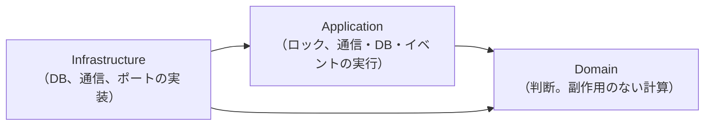
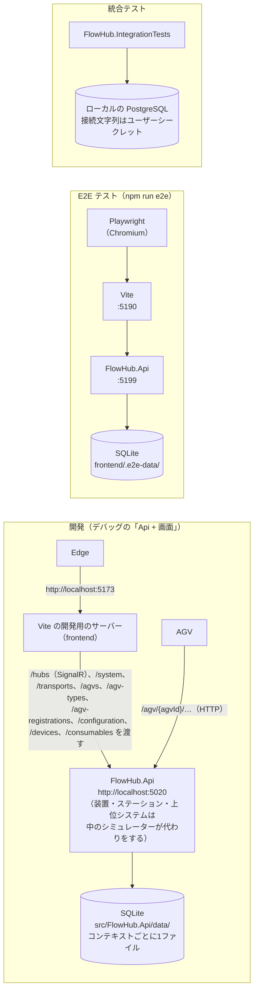
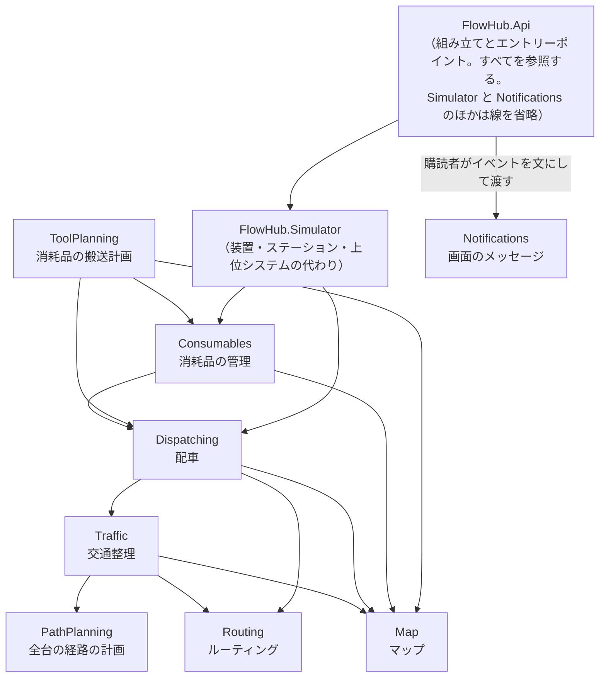

# CLAUDE.md

## プロジェクト概要

**flow-hub** は AGV（無人搬送車）の配車システムです。次の2つを扱います。

1. **AGV の配車**
2. **消耗品の管理**

## ドキュメント

| ファイル | 内容 |
|---|---|
| [docs/domain.md](docs/domain.md) | ドメイン仕様（消耗品、搬送方式、ステーション、配車、充電、段取り替えなど） |
| [docs/open-issues.md](docs/open-issues.md) | 未決事項（仕様が決まっていないもの） |
| [docs/backlog.md](docs/backlog.md) | やることリスト（仕様は決まっているが、まだ実装していないもの） |
| [docs/plan.md](docs/plan.md) | 作業計画（実装を進める順番と、それぞれの状態） |
| [docs/agv-protocol.md](docs/agv-protocol.md) | AGV との通信の仕様（URL、JSON の形式） |
| [docs/screens.md](docs/screens.md) | 画面仕様（画面の一覧、権限、画面ごとの中身） |

- 設計の検討や仕様に関わる作業の前に、**docs/domain.md と docs/open-issues.md を読みます**。
- 仕様が決まったら、docs/domain.md に反映し、docs/open-issues.md から該当する項目を削除します。
- 新しい未決事項が見つかったら、docs/open-issues.md に追加します。
- 未決事項を追加・削除したときは、**番号を連番に振り直します**。
- 作業を始めるときは docs/plan.md で次の作業を確かめ、小ステップを終えたら状態を更新します。
- ドキュメントは日本語で書きます。
- ユーザーへの回答も、**日本語** で書きます。

## 現在のフェーズ

**実装フェーズ**です。
- 未決事項は、実装を進めながら詰めていきます。仕様が決まったら、docs/domain.md と docs/open-issues.md に反映します。
- **仕様は勝手に判断しません。毎回ユーザーに確認します。**
  - 仕様に書かれていないことは、実装の前に必ず確認します。仕様から導けそうに見えることでも、同じです。
  - とくに、既定値、境界の扱い（ちょうどの値、0件、空など）、優先する順番、複数の候補からの選び方、異常のときの扱い、状態の遷移は、振る舞いを決める仕様なので確認します。
  - 確認する前に「〜と推測しました」と書いて実装を進めることもしません。確認が済んでから実装します。
  - 確認して決まった内容は、docs/domain.md に反映します。
  - 確認しないまま推測で実装してしまったものは、docs/open-issues.md の「確認待ち」の表に載せ、確認が済むまで残します。
  - 振る舞いに影響しない純粋な技術の選択（データ構造、アルゴリズム、クラスの分け方など）は、確認しなくてかまいません。

## 開発方針

### テスト駆動開発（TDD）

- テストを先に書き、Red → Green → Refactor のサイクルで進めます。
- テストのない本番コードは追加しません。

### クリーンアーキテクチャ

- 依存の向きは外側から内側への一方向に限ります（内側の層は外側の層を知りません）。


- ドメイン（配車ロジックなどのビジネスルール）を、フレームワーク・DB・外部機器との通信から切り離します。
- 外部とのやり取りはインターフェース（ポート）を内側の層で定義し、外側の層で実装します。

### 設計の観点（実装とレビューで確かめること）

コードを書くときと、レビューするときは、次の観点で確かめます。

#### 副作用の分離

- **判断は副作用のない計算にし、副作用は外側で実行します。** ドメインは、状態を進めて「やること」（命令や判断の結果）を返すだけにし、通信・DB・イベントの公開・タイマーは Application の層が実行します（例：`Transport` が `TransportAction` を返し、`DispatchingService` が実行する）。
  - 順番や選び方の判断（止める先の選び方、候補の並べ方など）は、Application の層に書かず、Domain の純粋な関数に切り出します。
- **後始末（番号の保存、イベントの公開、待っている要求を起こす、など）は1か所にまとめ、ロックを取る入り口はすべてそこを通します。** 後始末は、呼び出した対象だけでなく、**処理の中で変わったものすべて** に対して行います。
- 返り値を素通しするように見える関数の中で、フィールドやフラグを書き換えません。後始末に要る情報は、返り値の型で明示します。
- **ロックを持ったまま、外部（装置、ステーション、上位システム、AGV）との通信を待ちません。** ロックの中では状態を変えて出す命令を決めるだけにし、通信はロックを外してから行います。
  - 通信より先に状態を書き換えるときは、通信に失敗したときにどう扱うか（戻すか、やり直すか）を決めます。この扱いは振る舞いの仕様なので、ユーザーに確認します。
- ほかの集約と共有している状態（パネルの予約など）を書き換えるときは、その変化が呼び出した側から見えるようにします。
- **複数のロックを取るときは、取る順番を決めて守ります**（デッドロックを防ぐため）。ロックの中から、別の集約のロックを取る入り口を呼びません。
- **`lock` の中で `await` しません。** `SemaphoreSlim` などで `await` をまたぐときは、`await` の前後で状態が変わっている前提で書きます。
- **外部との通信には、必ずタイムアウトと `CancellationToken` を付けます。** タイムアウトしたときにやり直すかどうかは振る舞いの仕様なので、ユーザーに確認します。

#### 契約による設計

- **値の型は、作るときに検証します**（範囲、正の値、値の大小の関係など）。検証を通らない値を作れないようにします。
  - `struct` の値の型は、`default` で作ると検証を通らずにできてしまいます。`default` を使えないようにするか、`class` にします。
- **失敗の伝え方をそろえます。** 呼び出し側の誤り（契約違反）は例外、業務上の断り（予約が取れない、取りやめられない、など）は結果の型（enum や結果の record）で返します。同じ種類の操作で、`bool`・enum・例外を混ぜません。
- **不変条件は型の側に置きます。** 状態は、成り立たない組み合わせを作れない形（段階の enum や、状態ごとの型）で持ち、フラグの組み合わせで表しません。「終わった段階か」などの判定は、使う側で書き直さず、型のメソッドにします。
- **暗黙の約束に頼りません。** 「命令の一覧の最後はいつも移動」「組み立てが起動したらまず停止にする」のような約束は、コードかテストで保証します。
- ロックの外で状態を読んでから、ロックを取って処理しません（読んだあと、ロックを取るまでに状態が変わりうるため）。
- **外部（AGV、装置、ステーション、上位システム）からの報告が、重なって届いたり、順番が入れ替わって届いたりしても、結果が崩れないようにします。** 同じ報告が2回届いたとき、古い報告が後から届いたときの扱い（番号や時刻で古いものを捨てる、など）を決めます。この扱いは振る舞いの仕様なので、ユーザーに確認します。
- 外から来た値は、境界（`Infrastructure`）で値の型に変換して検証し、内側には検証を通った値の型だけを渡します。

#### 制御とデータ型の抽象化

- **ID や単位のある値は、ただの数値や文字列にせず、値の型にします**（`AgvId`、`PanelId`、`Heading` など）。
- **コンテキストの公開インターフェースには、ほかのコンテキストの内部の型を出しません。** とくに、ルーティングの型（`Pose` など）は、交通整理の公開インターフェースから外へ出さず、マップの型（`PanelId`、`Heading`）で表します。ルーティングを差し替えても、配車から上が影響を受けないようにするためです。
- 文字列で中身を表す約束事（受け渡しの相手の `"device:…"` など）は、1つの型の中に閉じ込め、組み立て方と読み方を散らしません。同じ約束事を、複数のコンテキストで別々に作りません。
- **集約は型にします。** 1つのものの状態を、同じ ID をキーにした辞書を何本も並べて持たず、集約の型にまとめます。状態の変わり方は、集約のメソッドで閉じます。
- 似た制御（ロックを取って処理する包み、「システムが動かせるか」の判定など）を、名前は同じで中身の違う形で、あちこちに書きません。共通にするか、名前を分けます。
- **集約の中のリストや辞書を、そのまま外に返しません。** `IReadOnlyList` などの読み取り専用の形か写しで返し、外から状態を書き換えられないようにします。
- 業務の意味（「なし」「未割り当て」など）を `null` で表さず、型（状態ごとの型や enum）で表します。

#### 安全側に倒す

- **わからない状態では、動かさない側に倒します。** 位置がわからない、通信が切れた、報告が食い違う、といったときは、止める・予約を手放さない側を既定にします。どう倒すかは振る舞いの仕様なので、ユーザーに確認します。
- **例外を握りつぶしません。** `catch` して処理を続けるときは、どの状態に戻したか（または戻さなかったか）をコードで明示します。
- **`switch` は、すべての場合を扱います。** 想定外の値は `default` で例外にし、状態や種類を増やしたときに、扱い漏れに気づけるようにします。

#### 再起動と永続化

- **プロセスが落ちて再起動しても、状態を戻せるようにします。** メモリにだけある状態（パネルの予約、搬送の段階など）を、再起動のときにどう扱うか（DB から戻す、捨てて安全側から始める、など）を決めます。この扱いは振る舞いの仕様なので、ユーザーに確認します。
- **保存してから、イベントを公開します。** 保存に失敗したのに、イベントだけが届くことがないようにします。

#### 判断の理由と用語

- **判断の結果には、「なぜそれを選んだか」も含め、ログに出します**（AGV の割り当て、止める先の選び方など）。現場で「なぜこの AGV が来たのか」を後から追えるようにするためです。理由はドメインの純粋な関数が返り値で返し、ログに出すのは Application の層です。
- **クラス名・メソッド名は、docs/domain.md の用語に合わせます。** 新しい概念に名前を付けたら、docs/domain.md にも載せます。

### コード分析の指摘

- コード分析の指摘を抑える特例（`SuppressMessage` 属性、`#pragma warning disable` など）は、**できるだけ使いません**。同じ振る舞いのまま、指摘を受けない書き方を探します。
- どうしても特例が必要なときは、ユーザーに確認します。

### 外部とのやり取りと時刻

- 外部の機器やシステム（AGV、装置、ステーション、上位システム）とのやり取りは、**すべてポート（インターフェース）を通します**。ドメインのロジックから、通信の実装を直接呼びません。
  - 本番では本物との通信の実装を、シミュレーターやテストではモックを、`FlowHub.Api` での組み立てのときに設定で差し替えます。
- 現在時刻は **`TimeProvider` を注入して取得** します。`DateTime.Now`、`DateTime.UtcNow`、`DateTimeOffset.Now` などを直接使いません。
  - テストやシミュレーターで、時間を早送りしたり止めたりできるようにするためです。テストでは `FakeTimeProvider` を使います。
- シミュレーター用のデータ（マップ、在庫など）が本番のデータと混ざらないよう、DB の接続先は環境ごとに分けます。

### サードパーティーのライブラリ

- **サードパーティーのライブラリは、基本的に使いません。** 標準ライブラリと .NET 公式のパッケージ（`Microsoft.*`、`System.*`）で済むものは、それを使います。小さな仕組みは自前で実装します。
- どうしても使うときは、次の条件をすべて満たすものに限ります。
  - **商用で使える OSS** であること。MIT、Apache-2.0、BSD などの寛容なライセンスを基本とします。
  - GPL や AGPL などの **コピーレフトのライセンスは使いません**。
  - 商用ライセンスが必要なもの、商用利用に条件があるもの（例：MediatR、FluentAssertions の v8 以降）は使いません。
- 新しく追加するときは、**ライセンスを確認したうえで、ユーザーに確認してから** 追加し、下の表に載せます。バージョンを上げるときも、ライセンスが変わっていないか確認します。

| パッケージ | 用途 | ライセンス |
|---|---|---|
| xunit.v3 | テスト | Apache-2.0 |
| Npgsql.EntityFrameworkCore.PostgreSQL | 本番の DB（PostgreSQL）とのやり取り（EF Core） | PostgreSQL |
| Npgsql | PostgreSQL のドライバー（上の部品が使う） | PostgreSQL |
| @microsoft/signalr（npm） | 画面のリアルタイム更新（SignalR のブラウザ側のクライアント。Microsoft 公式） | MIT |
| react、react-dom（npm） | 画面を作る | MIT |
| typescript（npm） | 画面の型の確かめ | Apache-2.0 |
| vite、@vitejs/plugin-react（npm） | 画面の開発用のサーバーとビルド | MIT |
| storybook、@storybook/react-vite（npm） | 画面の部品を1つずつ確かめる | MIT |
| @types/react、@types/react-dom（npm） | React の型 | MIT |
| tailwindcss、@tailwindcss/vite（npm） | 画面の見た目（CSS） | MIT |
| vitest（npm） | 画面のテスト | MIT |
| jsdom（npm） | 画面のテストで、ブラウザーの代わりをする | MIT |
| @playwright/test（npm） | 画面を本物のブラウザーで確かめる E2E テスト（Microsoft 製。依存の playwright、playwright-core も Apache-2.0） | Apache-2.0 |

- npm のパッケージは、依存しているものも含めてライセンスを確かめています。vite が CSS の処理に使う **lightningcss は MPL-2.0** です（ファイル単位の弱いコピーレフト）。ビルドの道具の中でだけ動き、配る成果物には入らず、手を加えずに使うので、使ってよいことにしています。
- @microsoft/signalr の依存先（Node.js で動かすときに使う ws、node-fetch、eventsource、fetch-cookie、tough-cookie など）も、MIT、BSD、Unlicense（パブリックドメイン相当）で、コピーレフトのものはありません。

### 開発の道具（VS Code）

- 開発は **VS Code** で行います。設定は `.vscode/`（`extensions.json`、`settings.json`、`launch.json`、`tasks.json`）と `.editorconfig` にあります。
  - デバッグは「Api + 画面」で、Api（http://localhost:5020）と画面（Vite の開発用のサーバー、http://localhost:5173 を Edge で）を一緒に起こします。
  - テスト、統合テスト、マイグレーションを作る、画面の型の確かめ・テスト・E2E・Storybook は、タスク（「タスクの実行」）から流せます。
  - `.editorconfig` には、書き方（字下げ、文字コード、行末の空白）だけを書きます。コード分析の指摘の重さやスタイルの規則は、ここで変えません（変えると、指摘を抑える特例と同じになるため）。
- 開発の道具にも、ライブラリと同じ条件（商用で使えること、商用の利用に条件がないこと）を当てはめます。
  - **C# Dev Kit（`ms-dotnettools.csdevkit`）は使いません**（商用の組織で使うには Visual Studio の契約が要るため）。C# のテストは、テストエクスプローラーではなく、タスクとターミナルから流します。
  - **Docker は使いません**（商用の利用に条件があるため）。統合テストの PostgreSQL は、ローカルに入れたものを使います。
  - TypeScript 7 の拡張機能（`typescriptteam.native-preview`）は、まだ試しの段階のため入れません。エディターの補完は VS Code に組み込みの TypeScript で、型の確かめは `npm run typecheck` で行います。

| 拡張機能 | 用途 | ライセンス |
|---|---|---|
| ms-dotnettools.csharp | C# の補完、デバッグ | MIT（同梱の言語サーバーとデバッガーは Microsoft のライセンス。VS Code などと一緒に使うこと、ほかへ配らないことが条件で、商用の開発に使えます） |
| ms-dotnettools.vscode-dotnet-runtime | .NET Install Tool（上の拡張機能と一緒に入る） | MIT |
| vitest.explorer | 画面のテストを、エディターから流す | MIT |
| ms-playwright.playwright | E2E テストを流す、デバッグする | Apache-2.0 |
| bradlc.vscode-tailwindcss | Tailwind のクラスの補完 | MIT |
| editorconfig.editorconfig | `.editorconfig` に従わせる | MIT |

開発のときのつながり：



### プロジェクトの構成（モジュラモノリス）

将来、既存の AGV 搬送システムと統合し、ルート計算を置き換える可能性があります。このため、サーバーサイドは **コンテキストごとにプロジェクトを分けたモジュラモノリス** にし、ルーティングを取り外したり差し替えたりできるようにします。

#### コンテキスト

| コンテキスト | プロジェクト | 責務 | 状態 |
|---|---|---|---|
| マップ | `FlowHub.Map` | マップの編集、検証、版の管理（スナップショット）、有効な版の公開 | 持つ |
| ルーティング | `FlowHub.Routing` | 1台の経路探索、移動コストの計算。マップは引数で受け取る | 持たない（計算だけ） |
| 全台の経路の計画 | `FlowHub.PathPlanning` | 全台の経路をまとめて計画する（時刻つきで先の AGV を避ける、パネルごとの通る順番）。AGV の位置などは引数で受け取る | 持たない（計算だけ） |
| 交通整理 | `FlowHub.Traffic` | パネルの予約、デッドロックの防止、走行の指示の分割と送信、位置の追跡、緊急停止 | 持つ |
| 配車 | `FlowHub.Dispatching` | 搬送の要求の受け付け、要求の間の調停（必要時刻の順）、AGV の割り当て、搬送の実行（状態遷移）、充電の判断、システムの運転状態（停止とスタート）。**運ぶものを知りません** | 持つ |
| 消耗品の搬送計画 | `FlowHub.ToolPlanning` | 消耗品の搬送の必要時刻（優先順位）の計算、加工の種類でまとめること、届ける順番、頼んだ搬送の中身（画面の搬送の一覧のため） | 持つ |
| 消耗品の管理 | `FlowHub.Consumables` | 消耗品、在庫、所在、ストッカーの設定、不足と設定外の判断、段取り替え | 持つ |
| 画面のメッセージ | `FlowHub.Notifications` | 画面で知らせるメッセージを残し、新しいほうから決まった件数を出す。何を知らせるか（イベントを文にすること）は組み立て（FlowHub.Api）の購読者が決める | 持つ |
| （将来）ワークの搬送計画 | `FlowHub.WorkPlanning` | ワークの搬送の必要時刻の計算、まとめ方。ワーク搬送を扱うときに作ります | － |

依存の向き（矢印は参照の向き）：

| コンテキスト | 参照してよい相手 |
|---|---|
| ToolPlanning | Consumables、Dispatching、Map |
| Consumables | Dispatching、Map |
| Dispatching | Traffic、Routing（割り当てのときに移動コストを聞く）、Map |
| Traffic | Routing、PathPlanning、Map |
| Routing | なし |
| PathPlanning | なし |
| Notifications | なし |
| Map | なし |



- 図の矢印は「参照してよい」向きです。イベントは、矢印と逆の向き（参照される側から、参照する側へ）に届きます。
- BuildingBlocks は、Routing と PathPlanning 以外のすべてが参照してかまいません（図では省略）。Notifications は、どのコンテキストにも BuildingBlocks にも依存せず、組み立て（FlowHub.Api）だけが参照します。

- **配車は、運ぶもの（消耗品やワーク）を知りません。** 搬送の要求は、運ぶものに依存しない汎用の形で受け取ります。
  - 要求には、要求元、運ぶものの参照（配車にとっては中身のわからない ID）、搬送元と搬送先、必要なキャリアの種類、まとめてよい組を表すキー、量、**必要時刻** を持たせます。
  - 優先度は、**「いつまでに必要か（必要時刻）」** にそろえます。運ぶものが違っても同じ尺度で比べられるようにするためです。配車は、必要時刻が早い順に、移動コストも考えて割り当てます。必要時刻を決められない要求のために、「急ぎ」「通常」程度の区分を併用してもかまいません。
  - 必要時刻の計算は、運ぶものの事情を知っている **搬送計画のコンテキスト** が行います。
  - 配車が公開するイベントには要求元を入れ、各コンテキストは自分が頼んだ搬送のイベントだけを処理します。
- **消耗品の管理を、ワーク管理に入れ替えたり、両立させたりできる** 構成にします。ワークを扱うときは、ワーク管理と `FlowHub.WorkPlanning` を加えるだけで、配車から下（交通整理、ルーティング、マップ）には手を入れずに済むようにします。

- Routing と PathPlanning 以外のコンテキストは、**`FlowHub.BuildingBlocks`** を参照してかまいません。**ルーティングと PathPlanning は BuildingBlocks にも依存しません。**
  - BuildingBlocks に入れるのは、**コンテキストの間のやり取りに使う技術的な部品だけ** です（`IIntegrationEvent`、`IEventSubscriber<T>`、`IEventPublisher`、イベントのメタデータ）。DDD の「設計の構成要素（Building Blocks）」とは別の意味です。
  - **ドメインの概念は入れません。** ID の型（`AgvId`、`PanelId` など）も、その概念を持つコンテキストの公開インターフェースに置きます（例：`AgvId` は交通整理、`PanelId` はマップ）。
  - BuildingBlocks は、どのコンテキストも参照しません。

- **全台の経路の計画（PathPlanning）も、ほかのコンテキストに依存しません**（BuildingBlocks にも、ルーティングにも依存しません）。ルーティングと同じく、状態を持たない計算に限り、自分専用の入力の形（ノードと辺のグラフ、AGV の姿勢など）を持ちます。ルーティングを既存システムのルート計算に差し替えても、影響を受けないようにするためです。
  - 交通整理が、AGV の位置、渡した指示、止まっている AGV などを引数で渡して呼びます。計画から取り出した「パネルごとの通る順番」を守らせるのは、交通整理です。
- **ルーティングは、ほかのコンテキストに依存しません。** マップのコンテキストにも依存せず、マップは引数で受け取ります。状態を持たない計算に限ることで、予約や位置などの状態を一緒に移さずに取り外せるようにします。
  - ルーティングは自分専用の入力の形（ノードと辺のグラフ）を持ちます。マップのスナップショットからこの形に変換するのは、呼び出す側の役割です。
- **安全（AGV 同士の衝突の防止）は、ルーティングに頼りません。** 交通整理が、経路上のパネルを **すべて予約できたときだけ** 走行の指示を出すことで保証します。ルーティングは効率にだけ関わります。
  - ルーティングを何に置き換えても、安全は崩れず、効率が変わるだけで済むようにするためです（既存システムのルート計算は、予約済みのパネルを避ける入力を受け取れません）。
  - ルーティングの入力に「避けるパネル」は含めません。避けたいパネルがあるときは、呼び出す側がグラフから取り除いてから渡します。
- **マップは、変更できないスナップショットとして公開します。** 走行中にマップが書き換わって、予約の前提が崩れないようにするためです。版の編集と管理はマップのコンテキストが、どの版で動くか（版の切り替えのタイミング）は交通整理が受け持ちます。
- **AGV の状態（位置、充電残量、エラー）は交通整理が持ちます。** 配車は、交通整理からの通知を受けて参照します。充電に行かせるかどうかの判断は配車が行い、充電ポートまで動かすのは交通整理です。
- **ステーション** は仕様が変わりやすいため、仕様が固まるまでは消耗品の管理の中で、切り離して差し替えられる形にしておきます。独立したコンテキストにはしません。

#### 新しい機能をどこに置くか

新しい機能を、別のプロジェクト（コンテキスト）に分けるか、既存のプロジェクトに足すかは、次の指標で決めます。

**分ける理由**（どれか1つでも当てはまれば、別のプロジェクトにする）

| 問い | 例 |
|---|---|
| **取り外したり、差し替えたりする単位か**。将来、別のものに置き換える、なくす、両立させる見込みがあるか | ルーティングと全台の経路の計画（既存システムのルート計算に差し替える）。消耗品の管理（ワーク管理と入れ替える、両立させる） |
| **入れると、依存の向きが崩れるか**。知るべきでない相手を知る、矢印が逆を向く、輪になる | 画面のメッセージ（どのコンテキストに入れても、ほかのコンテキストのイベントを知ることになる）。配車は運ぶものを知らない |
| **自分の状態と DB のスキーマを持ち、変わる理由が違うか**。変える人、変える頻度、版の考え方が違う | マップ（版のスナップショット。編集するのは管理者）と交通整理（走っている間に刻々と変わる） |
| **同じ言葉が、違う意味になるか**。入れると、1つの型に2つの意味が混ざる | 「予約」は、交通整理ではパネル、消耗品の管理では届ける消耗品 |

**足す理由**（こちらが強ければ、既存のプロジェクトに足す）

| 問い | 例 |
|---|---|
| **既存の集約の状態を、同じロックや同じトランザクションで読み書きするか**。分けると、結果整合やイベントの往復が要るようになる | 段取り替え（ストッカーの設定と在庫を一緒に見る）は、消耗品の管理に足した |
| **既存のコンテキストの言葉だけで説明できるか** | 指名（AGV での交換）は、消耗品の管理の言葉で説明できる |
| **分けても、公開インターフェースが広がるだけか**。差し替える見込みがない | マニュアル操作は、交通整理に足した |

**あいだの選び方**：分ける理由がまだ確かでないとき（仕様が固まっていないときなど）は、**同じプロジェクトの中で、インターフェース（ポート）とフォルダで切り離して** おき、理由が確かになったら外に出します（例：ステーション）。

**組み立てでつなぐだけのもの**：状態を持たず、あるコンテキストのイベントを別の形に変えて渡すだけなら、プロジェクトにせず、組み立て（`FlowHub.Api`）の購読者にします（例：イベントを文にして、画面のメッセージに渡す）。状態を持つようになったら、分ける理由に当てはまるかを考え直します（画面のメッセージは「DB に残す」が加わって、`FlowHub.Notifications` に分けた）。

**判断の順番**
1. 組み立てでつなぐだけで済むかを見る。
2. 分ける理由に当てはまるかを見る。当てはまらなければ、既存のプロジェクトに足す。
3. 迷ったら、まず同じプロジェクトの中で切り離しておく。分けるのはあとからでもできるが、まとめ直すのは高くつくため。
4. 分けると決めたら、このファイルのコンテキストの表、依存の向きの表、ディレクトリと、アーキテクチャテスト（`tests/FlowHub.ArchitectureTests` の `ContextRules`）を、一緒に直す。
- 分けるか足すかは、構成の決めごとなので、ユーザーに確認してから決めます。

#### ルール

- **1つのコンテキストを1つのプロジェクト** にします。
- ほかのコンテキストに公開するインターフェースと DTO だけを `public` にし、**それ以外は `internal`** にします。テストからは `InternalsVisibleTo` で参照します。
- コンテキストの中は、**`Domain`、`Application`、`Infrastructure` のフォルダ（名前空間）** に分けます。層の間の依存の向きは「クリーンアーキテクチャ」の節に従います。
- コンテキストの間の依存と、層の間の依存は、**アーキテクチャテストで機械的に守らせます**。
- DB は、**コンテキストごとに PostgreSQL のスキーマを分けます**。ほかのコンテキストのテーブルは直接読みません。
- DB とのやり取りには **EF Core** を使います。本番は **PostgreSQL**、テストとデバッグは **SQLite** で、設定で切り替えます。
  - SQLite にはスキーマがないので、**コンテキストごとに別の DB ファイル** にします。
  - マイグレーションは **PostgreSQL 用だけ** 作ります。SQLite は、今のモデルからテーブルを作ります（`EnsureCreated`）。
    - マイグレーションを作る道具（`dotnet-ef`）は、リポジトリのローカルツールです（初めて使うときは `dotnet tool restore`）。
    - 作り方：`dotnet ef migrations add <名前> --project src/FlowHub.<コンテキスト> --startup-project src/FlowHub.Api --context <コンテキスト>DbContext --output-dir Infrastructure/Migrations`
    - DbContext は、コンテキストの `Infrastructure` に `internal` で置きます。組み立て側には、DB の設定を受け取って開く入り口（例：`MapDatabase.OpenAsync`）だけを公開します。
  - DB に頼む検索は単純に保ちます（DB の種類による違いを避けるため）。
  - DB を使うテストは、基本的に **SQLite** で流します。テストは、できるだけ **軽く、たくさん回せる** ように保ちます。
  - **ローカルの PostgreSQL** を使うのは、**最後の統合テストだけ** です。
    - 統合テストは `tests/FlowHub.IntegrationTests` に置きます。ふだんの `dotnet test` には **含めません**（PostgreSQL なしで軽く回せるようにするため）。
    - 流すときは `dotnet test --project tests/FlowHub.IntegrationTests -p:RunIntegrationTests=true` とします。DB の部分（マイグレーションやテーブルの作り）を変えたとき、push する前に流します。
    - 接続文字列は **ユーザーシークレット** に置きます（リポジトリに入れないため）。雛型は `tests/FlowHub.IntegrationTests/secrets.template.json`、使い方は同じディレクトリの `README.md` にあります。環境変数があれば、そちらを優先します。
      - 設定のしかた：`dotnet user-secrets set "Postgres:ConnectionString" "Host=localhost;..." --project tests/FlowHub.IntegrationTests`
- `FlowHub.Api` は、各コンテキストの組み立てとエントリーポイントだけを担当します。
- `FlowHub.Simulator` は、本物の通信ができるまで、装置・ステーション・上位システムのポートを仮に実装するシミュレーターです（コンテキストではありません）。参照してよいのは消耗品の管理と配車だけで、参照するのは `FlowHub.Api` だけです。

#### コンテキストの間のやり取り

- **頼みごとは「呼び出し」で、結果の知らせは「イベント」で** 行います。
  - 依存している相手へは、公開インターフェースを呼び出します。
  - 依存されている相手へ知らせるとき（依存の向きの都合で呼び出せないとき）だけ、イベントを使います。**イベントは最小限** にし、それ以外は普通の呼び出しにします。
- イベントは、**公開する側のコンテキストの公開インターフェースに定義** します。購読する側はもともと公開する側に依存しているので、参照は依存の向きのままで循環しません。
- **C# の `event`（デリゲート）は使いません。** イベントは過去形の名前の `record` にし、購読は `IEventSubscriber<TEvent>` を実装したクラスで行います。IDE の「実装へ移動」で購読者を、「すべての参照を検索」で公開している箇所を追えるようにするためです。
- **購読の登録は、DI の自動スキャンを使わず、コンテキストごとに1つのファイル（`Subscriptions.cs`）に明示的に書きます。**
- **流れは1か所に書きます。** 搬送の流れは、配車の中で「搬送」の状態遷移として明示します。イベントは状態遷移への入力としてだけ使い、**イベントを受けて別のイベントを連鎖させる作りは避けます**。
- すべてのイベントに **`EventId`、`CorrelationId`（一連の流れの ID。例：搬送 ID）、`CausationId`（直接のきっかけの ID）** を持たせ、ログに出します。トレースには .NET 標準の `Activity` を使います。
- 届け方は、イベントの公開と購読をインターフェースで抽象化したうえで、**最初は「DB のコミット後に、プロセス内で届ける」実装** にします。必要になったら、失われない **アウトボックス方式** に差し替えます。
  - このため、**購読する側は、同じイベントが2回届いても結果が変わらないように（冪等に）** 作ります。
  - コンテキストをまたぐ更新は、1つのトランザクションにまとめず、**イベントによる結果整合** にします。
- MediatR は商用ライセンスに変わったため使いません。イベントの仕組みは小さく自前で実装します。
- アーキテクチャテストで、次のルールを守らせます。
  - 購読してよいのは、依存してよい相手のイベントだけ
  - イベントを公開できるのは `Application` の層だけ
  - 公開されているのに、誰も購読していないイベントがない

#### ディレクトリ

```
src/
  FlowHub.BuildingBlocks/
  FlowHub.Map/
  FlowHub.Routing/
  FlowHub.PathPlanning/
  FlowHub.Notifications/
  FlowHub.Traffic/
  FlowHub.Dispatching/
  FlowHub.ToolPlanning/
  FlowHub.Consumables/
  FlowHub.Simulator/
  FlowHub.Api/
tests/
  FlowHub.Api.Tests/
  FlowHub.BuildingBlocks.Tests/
  FlowHub.Map.Tests/
  FlowHub.Routing.Tests/
  FlowHub.PathPlanning.Tests/
  FlowHub.Notifications.Tests/
  FlowHub.Traffic.Tests/
  FlowHub.Dispatching.Tests/
  FlowHub.ToolPlanning.Tests/
  FlowHub.Consumables.Tests/
  FlowHub.Simulator.Tests/
  FlowHub.IntegrationTests/
  FlowHub.ArchitectureTests/
frontend/            （画面。React + TypeScript + Vite + Tailwind CSS + Vitest + Storybook）
```

- テストフレームワークは **xUnit v3** を使います。テストの実行基盤は **Microsoft Testing Platform** です（`global.json` で指定）。`dotnet test` で全テストを実行します。
- テストがまだないテストプロジェクトには、csproj に `<AllowNoTests>true</AllowNoTests>` を付けます（0件でも失敗扱いにしないため）。**テストを書いたら外します。**
- 共通のビルド設定は `Directory.Build.props` に置きます（**警告はエラーとして扱います**）。テストプロジェクトの共通設定は `tests/Directory.Build.props` に置きます。
- NuGet パッケージのバージョンは、`Directory.Packages.props` で **一元管理** します。各プロジェクトには、バージョンを書きません。
- コンテキストの間の依存の向きは、`tests/FlowHub.ArchitectureTests` で守らせます。コンテキストを追加したり、依存の向きの表を変えたりしたときは、このテストの表も合わせて更新します。
- フロントエンドは React + TypeScript で作り、ほかのサードパーティーのライブラリは基本的に使いません（サーバー側と同じ方針）。画面のリアルタイム更新には SignalR を使います。画面の仕様は docs/screens.md にまとめます。
  - フロントエンドは **`frontend/`** に置きます。ビルドは **Vite**、見た目は **Tailwind CSS**、テストは **Vitest**、E2E テストは **Playwright**、部品の確かめは **Storybook** です。使い方は `frontend/README.md` にあります。
  - 画面のデザインの試作は、Artifact の「FlowHub 画面デザイン」にあります（https://claude.ai/artifact/WCtJNB5UUes8dXfkJBKxXf）。実装は、この試作をもとに進めます。

## 技術スタック

| 領域 | 技術 |
|---|---|
| サーバーサイド | ASP.NET（.NET 10） |
| フロントエンド | React + TypeScript |
| データベース | PostgreSQL |
