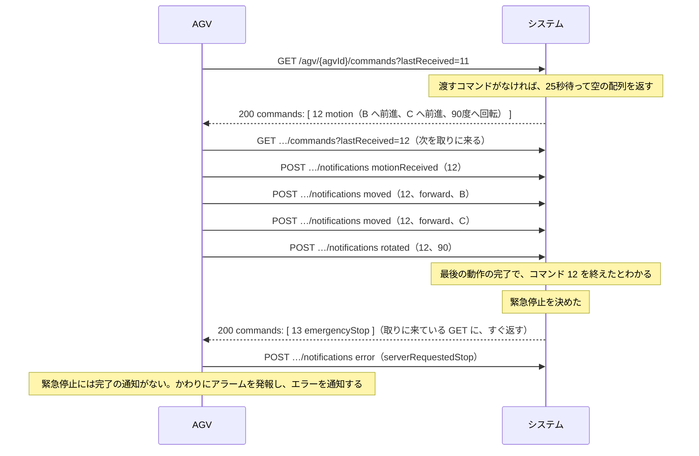

# AGV との通信の仕様

システム（サーバー）と AGV の間のやり取りの形式です。考え方は [domain.md](domain.md) の「AGV との通信（コマンドの受け渡し）」「AGV からの完了の通知」「AGV のエラー」に従います。

既存の AGV の通信仕様書はないので、この形式はこのシステムで決めたものです。既存の AGV とはそのままではつながりません。シミュレーターと、この形式に合わせた AGV が使います。既存の AGV やシステムと統合するときは、統合する側で形式を合わせます。

## 共通

| 項目 | 決めごと |
|---|---|
| 方式 | HTTP。AGV からシステムへ、リクエストを送る（システムから AGV へ送る経路はない） |
| データの形式 | JSON（UTF-8）。項目の名前は camelCase |
| AGV の名乗り方 | URL の中に AGV の ID を入れる（`/agv/{agvId}/...`） |
| 指示の番号 | JSON の整数（64 ビット）。1 から1つずつ増える。AGV が番号を持っていないときは `-1` |
| 距離 | 整数、mm |
| 角度 | 整数、度。絶対角度で 0〜359 |
| パネル | パネルの ID（文字列） |
| 認証 | なし（工場内の閉じたネットワークで使う前提） |

### 応答の状態コード

| コード | 意味 |
|---|---|
| 200 | 成功（中身あり） |
| 204 | 成功（中身なし）。通知は、重複や古い通知として無視したときも 204 を返す（AGV は気にしなくてよい） |
| 400 | 形式が読めない（知らない種類、項目が足りない、壊れた内容）。システムはログに残す |
| 404 | 登録されていない AGV |

## やり取りの流れ（例）

システムから AGV へ送る経路はないので、コマンドはいつも、AGV が取りに来た GET の応答で渡します。



- 再起動した AGV は、`lastReceived=-1` で取りに来て、`GET /agv/{agvId}/position` で位置を聞きます。システムは、走りかけだった動作コマンドを渡し直しません（[domain.md](domain.md) の「動作コマンドの受信の確認」）。

## 1. コマンドを取りに来る（ロングポーリング）

```
GET /agv/{agvId}/commands?lastReceived={番号}
```

- `lastReceived`：前回受け取ったコマンドの番号。初めて動かすときと、再起動したあとは `-1`。
- 渡すコマンドがあれば、**できたタイミングで、すぐに** 返す。
- 渡すコマンドがなければ、**25秒**（既定値。設定で変えられる）待って、空の配列を返す。
- AGV は、応答を受け取ったら、また GET を送る。

応答（200）：

```json
{
  "commands": [
    { "number": 12, "type": "motion", "steps": [
      { "action": "forward", "distanceMm": 800, "panel": "B" },
      { "action": "forward", "distanceMm": 800, "panel": "C" },
      { "action": "rotate", "heading": 90 }
    ] },
    { "number": 13, "type": "emergencyStop" }
  ]
}
```

- 1回の応答で、複数のコマンドを **番号の小さい順** に渡す。

### コマンドの種類

| `type` | 項目 | 内容 |
|---|---|---|
| `motion` | `steps` | 動作コマンド（1つの区間ぶんの動作の配列） |
| `emergencyStop` | なし | 緊急停止 |
| `alarmClear` | なし | アラームクリア |
| `positionReset` | `panel`、`heading` | 位置リセット（パネルと絶対角度を上書きする） |
| `lowerCarrier` | `heightMm`（省略できる） | キャリアを下げる。`heightMm` がなければ、AGV が高さを測る |
| `raiseCarrier` | なし | キャリアを上げる |

### 動作（`steps` の要素）

| `action` | 項目 | 内容 |
|---|---|---|
| `forward` | `distanceMm`、`panel` | 前進。次の十字のラインまでの距離と、移動先のパネル |
| `backward` | `distanceMm`、`panel` | 後退。項目は前進と同じ |
| `rotate` | `heading` | その場での回転。回転後の絶対角度 |
| `rotate_free` | `heading` | 角度を指定した、その場での回転（マニュアルで使う）。ラインを読まずに、回転後の絶対角度（0〜359度）まで回る。区間には、これ1つだけで入れる。終えたときの通知は `rotated` |
| `forward_special` | `distanceMm`、`panel` | 特殊な前進。特殊消耗品受け渡しパネルを出発するか、そこに着く前進。項目は前進と同じ。終えたときの通知は `moved`（`direction` は `forward`） |
| `backward_special` | `distanceMm`、`panel` | 特殊な後退。項目は後退と同じ。終えたときの通知は `moved`（`direction` は `backward`） |
| `rotate_special` | `heading` | 特殊消耗品受け渡しパネルで、キャリアを下ろす角度などへの、その場での回転。回転後の絶対角度（0〜359度）。`rotate_free` とは別の動作。終えたときの通知は `rotated` |

## 2. 位置を取りに来る（再起動したとき）

```
GET /agv/{agvId}/position
```

応答（200）：システムが最後に把握していた位置。

```json
{ "panel": "A", "heading": 90 }
```

- 位置がわからない（まだ位置リセットしていない）ときは、204 を返す。

## 3. 通知（完了、エラー、充電残量）

AGV からの通知は、すべて **同じ URL** に POST する。どの通知かは、JSON の `type` で分ける。

```
POST /agv/{agvId}/notifications
```

```json
{ "number": 12, "type": "moved", "direction": "forward", "panel": "B" }
```

- 応答は 204。

### 完了の通知

| `type` | 項目 | 内容 |
|---|---|---|
| `motionReceived` | `number` | 動作コマンドを受け取った（受信の完了） |
| `moved` | `number`、`direction`（`forward` / `backward`）、`panel` | 前進・後退を1つ終えた。着いたパネル |
| `rotated` | `number`、`heading` | 回転を終えた。回転後の絶対角度 |
| `carrierLowered` | `number` | キャリアが下がった |
| `carrierRaised` | `number` | キャリアが上がった |
| `carrierHeightMeasured` | `number`、`heightMm` | キャリアを下げる高さを測った |
| `alarmCleared` | `number` | アラームクリアを終えた |
| `positionResetCompleted` | `number` | 位置リセットを終えた |

- `number` には、そのコマンドの番号を入れる。

### エラーの通知

```json
{ "type": "error", "kind": "bumperPressed" }
```

| `kind` | エラー |
|---|---|
| `crossMissed` | 十字の検出漏れ |
| `crossFalselyDetected` | 十字の誤検出 |
| `bumperPressed` | バンパースイッチが押された |
| `communicationLost` | 通信が切れた（通信が戻ったときに通知する） |
| `batteryDepleted` | 充電切れ |
| `motorDriverError` | モーターのドライバーのエラー |
| `hardwareError` | ハードウェアのエラー |
| `serverRequestedStop` | サーバー要求エラー停止（緊急停止を受けたとき） |

### 充電残量の通知

```json
{ "type": "battery", "percent": 57 }
```

- 残量が変わったときに送る。`percent` は 0〜100 の整数。
