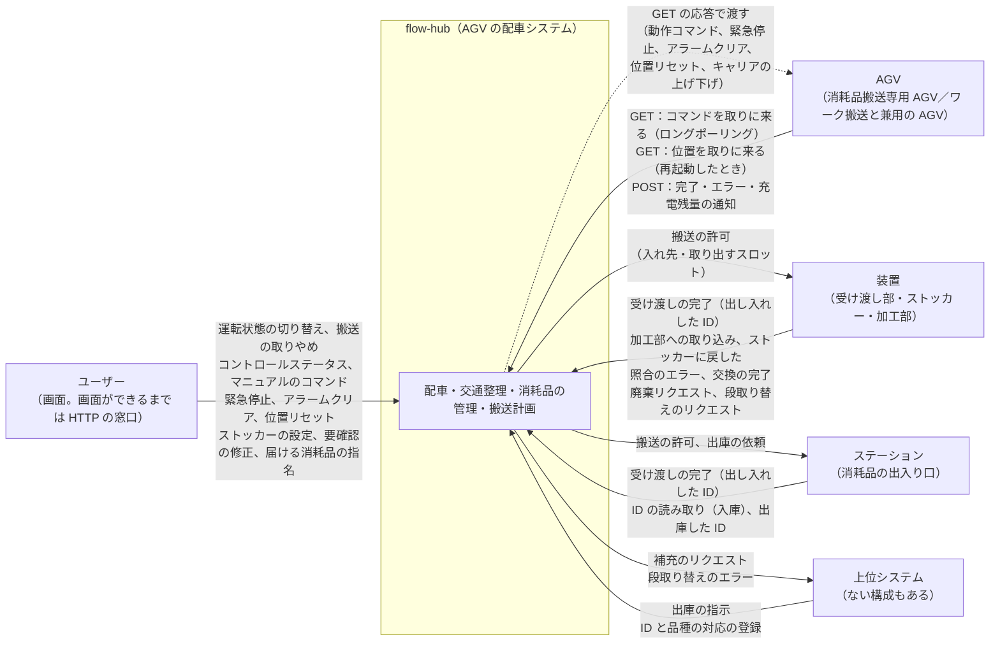

# A1. システムの全体像（コンテキスト図）

flow-hub と、やり取りする外部（人、AGV、装置、ステーション、上位システム）の関係です。

- 根拠：[domain.md](../domain.md)「AGV との通信（コマンドの受け渡し）」「受け渡しの手順」「装置から受け取る情報」「ID の照合が合わないとき」「ステーション」「上位システムとの連携」「消耗品の在庫管理」、[agv-protocol.md](../agv-protocol.md)
- AGV とのやり取りの方式は [agv-protocol.md](../agv-protocol.md) で決まっています。装置・ステーション・上位システムとのやり取りの方式は **未定** です（未決事項 #11）。今は、ポート（インターフェース）を通して、シミュレーター（`FlowHub.Simulator`）が仮に実装しています。

## 補足

- AGV へは、システムから直接送る経路がありません。AGV が GET で取りに来たときに、応答でコマンドを渡します（点線）。
- 上位システムがない構成では、補充のリクエストと段取り替えのエラーは、**ユーザーに知らせる** 実装に差し替えます。
- ID と品種の対応は、上位システムか人が、前もって登録します。
