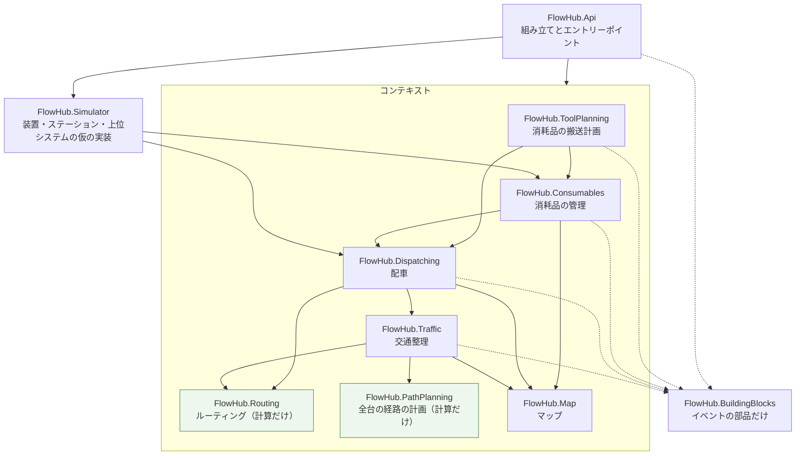

# A2. コンテキストの依存関係（コンポーネント図）

モジュラモノリスのプロジェクト（コンテキスト）と、参照の向きです。矢印は「参照する側 → 参照される側」です。

- 根拠：[CLAUDE.md](../../CLAUDE.md)「プロジェクトの構成（モジュラモノリス）」、各 `src/*/*.csproj` の `ProjectReference`
- この向きは `tests/FlowHub.ArchitectureTests` で機械的に守らせています。

## 依存の向きの表

| コンテキスト | 参照してよい相手 | 今の参照（csproj） |
|---|---|---|
| ToolPlanning | Consumables、Dispatching、Map | Consumables、Dispatching、BuildingBlocks |
| Consumables | Dispatching、Map | Dispatching、Map、BuildingBlocks |
| Dispatching | Traffic、Routing、Map | Traffic、Routing、Map、BuildingBlocks |
| Traffic | Routing、PathPlanning、Map | Routing、PathPlanning、Map、BuildingBlocks |
| Routing | なし | なし |
| PathPlanning | なし | なし |
| Map | なし | なし（BuildingBlocks は参照してよいが、今は使っていない） |

## 読み方

- **Routing と PathPlanning**（緑）は、状態を持たない計算だけのコンテキストです。BuildingBlocks にも、マップにも依存しません。入力は自分専用の形（ノードと辺のグラフ、AGV の姿勢など）で受け取ります。既存の AGV 搬送システムのルート計算に差し替えられるようにするためです。
- **配車は、運ぶものを知りません。** 消耗品の管理と搬送計画が配車を参照し、逆はありません。ワークを扱うときは、ワーク管理と `FlowHub.WorkPlanning` を、ToolPlanning・Consumables と並べて加えます（配車から下には手を入れません）。
- 依存されている側（たとえば交通整理）から依存している側（配車）へ知らせるときだけ、イベントを使います（[A4. イベントの流れ](04-events.md)）。
- `FlowHub.Simulator` はコンテキストではありません。参照してよいのは消耗品の管理と配車だけで、参照するのは `FlowHub.Api` だけです。
