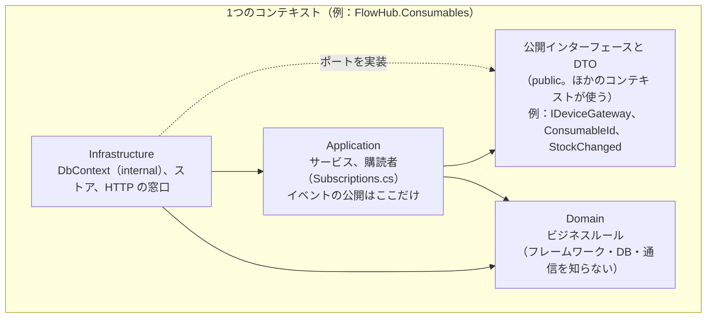
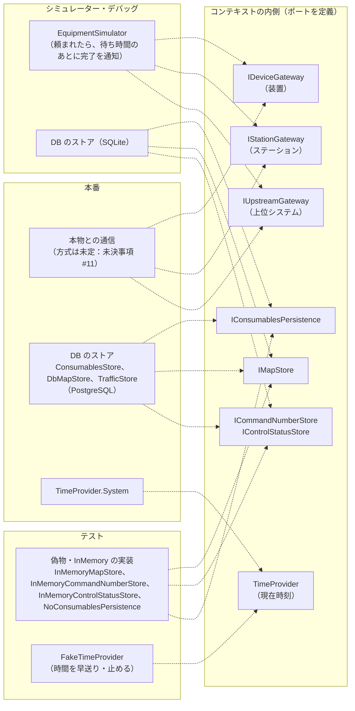

# A3. コンテキストの中の層とポート（層の図）

コンテキストの中の `Domain`、`Application`、`Infrastructure` と、外部とのやり取りを通すポート（インターフェース）の関係です。

- 根拠：[CLAUDE.md](../../CLAUDE.md)「クリーンアーキテクチャ」「外部とのやり取りと時刻」「ルール」、`tests/FlowHub.ArchitectureTests/LayerAndEventRulesTests.cs`

## 層の依存の向き

- 矢印は「使う側 → 使われる側」です。内側（Domain）は外側（Application、Infrastructure）を知りません。
- アーキテクチャテストで守らせていること：
  - Domain の層は、Application と Infrastructure の層を使わない
  - Application の層は、Infrastructure の層を使わない
  - イベントを公開できるのは Application の層だけ

## ポートと、差し替える実装

外部とのやり取りは、すべてポートを通します。本番・シミュレーター・テストで、`FlowHub.Api` の組み立てのときに実装を差し替えます。

## 入ってくる側の窓口

| 窓口 | 置き場所 | 内容 |
|---|---|---|
| AGV との通信（`/agv/{agvId}/...`） | `FlowHub.Traffic/Infrastructure/AgvEndpoints.cs` | コマンドのロングポーリング、位置の取得、通知（[agv-protocol.md](../agv-protocol.md)） |
| 運転状態（`/system/...`） | `FlowHub.Api/Composition/SystemEndpoints.cs` | 状態の取得、スタート、停止 |
| 搬送の取りやめ（`/transports/{id}/cancel`） | `FlowHub.Api/Composition/TransportEndpoints.cs` | 割り当てたあとの搬送の取りやめ |
| 装置・ステーションからの通知 | 今は `FlowHub.Simulator` が `ConsumablesService` を直接呼ぶ | 本物との通信の方式が決まったら、窓口を作る（未決事項 #11） |
