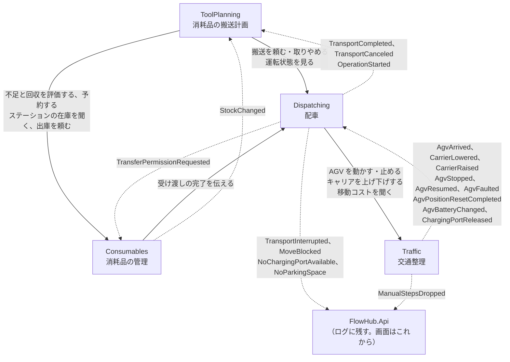
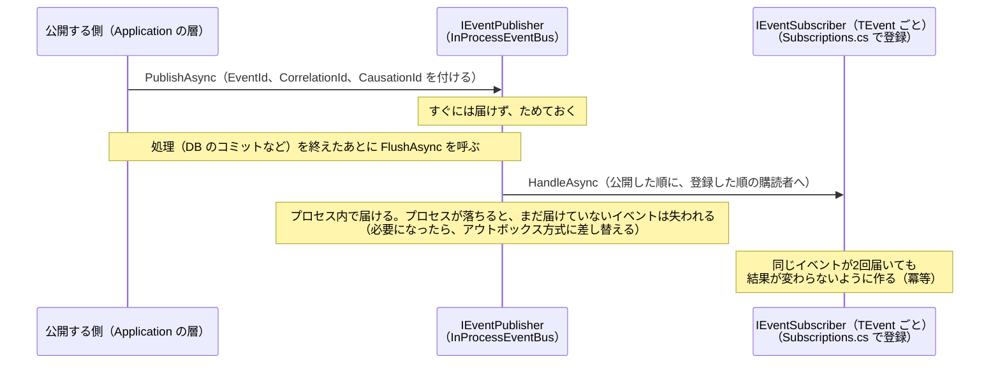

# A4. コンテキストの間のやり取り（呼び出しとイベント）

どのコンテキストが、誰を呼び出し、どのイベントを公開し、誰が購読するかの一覧です。

- 根拠：[CLAUDE.md](../../CLAUDE.md)「コンテキストの間のやり取り」、各コンテキストの `*Events.cs` と `Subscriptions.cs`（`src/FlowHub.Api/Subscriptions.cs` を含む）
- 決まりごと：**頼みごとは「呼び出し」、結果の知らせは「イベント」**。依存されている側から依存している側へ知らせるとき（依存の向きの都合で呼び出せないとき）だけ、イベントを使います。

## 全体

実線は呼び出し（依存の向き）、点線はイベント（逆向きの知らせ）です。

## イベントの一覧

| 公開する側 | イベント | 意味 | 購読する側 |
|---|---|---|---|
| 交通整理 | `AgvArrived` | AGV が行き先のパネルに着いた | 配車 |
| 交通整理 | `CarrierLowered` | キャリアが下がった | 配車 |
| 交通整理 | `CarrierRaised` | キャリアが上がった | 配車 |
| 交通整理 | `AgvStopped` | AGV が緊急停止中になった | 配車 |
| 交通整理 | `AgvResumed` | アラームクリアが完了して再開した | 配車 |
| 交通整理 | `AgvFaulted` | AGV が異常になった（位置リセットが必要） | 配車 |
| 交通整理 | `AgvPositionResetCompleted` | 位置リセットが完了した | 配車 |
| 交通整理 | `AgvBatteryChanged` | 充電残量が変わった | 配車 |
| 交通整理 | `ChargingPortReleased` | 充電ポートが空いた | 配車 |
| 交通整理 | `ManualStepsDropped` | マニュアルで並べた動作を、予約が取れずに止めて捨てた | 組み立て（ログ） |
| 配車 | `TransferPermissionRequested` | 受け渡しの相手に、搬送の許可を出してほしい | 消耗品の管理 |
| 配車 | `TransportCompleted` | 搬送が完了した | 搬送計画 |
| 配車 | `TransportCanceled` | 割り当てたあとの搬送を取りやめた（積んだまま止まったかを含む） | 搬送計画 |
| 配車 | `OperationStarted` | 運転状態がスタートになった | 搬送計画 |
| 配車 | `TransportInterrupted` | 搬送を中断した | 組み立て（ログ） |
| 配車 | `MoveBlocked` | 予約が取れずに止まっている | 組み立て（ログ） |
| 配車 | `NoChargingPortAvailable` | 行ける充電ポートがない | 組み立て（ログ） |
| 配車 | `NoParkingSpace` | 停止にしたとき、止める先がなかった | 組み立て（ログ） |
| 消耗品の管理 | `StockChanged` | 在庫や所在が変わった（判断のやり直しのきっかけ） | 搬送計画 |

## 届け方

- 配車が公開する搬送のイベントには、要求元（`Requester`）が入ります。各コンテキストは、自分が頼んだ搬送のイベントだけを処理します。
- イベントを受けて別のイベントを連鎖させる作りは避け、搬送の流れは配車の中の状態遷移（[B5. 搬送の状態遷移](05-transport-state.md)）に1か所で書きます。
