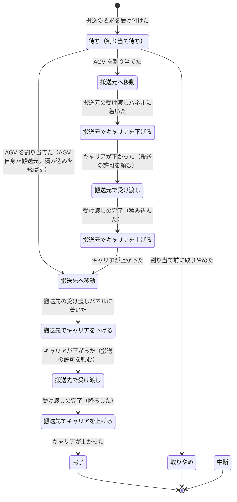
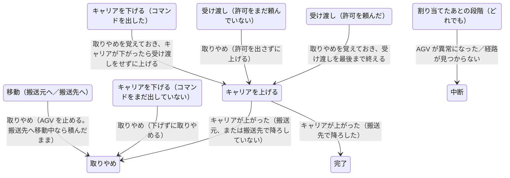
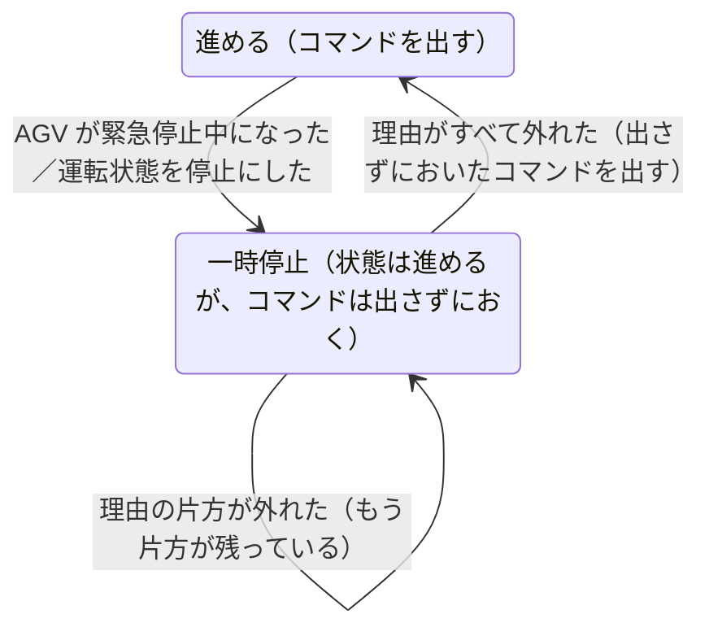

# B5. 搬送の状態遷移

1回の搬送（1往復）の段階と、何をきっかけに次の段階へ進むかです。届けるときも回収するときも同じ流れで、どちらで積み込み、どちらで降ろすかが違うだけです。

- 根拠：[domain.md](../domain.md)「搬送の流れ」「受け渡しの手順」「AGV の割り当て」、`src/FlowHub.Dispatching/Domain/Transport.cs`（`TransportStage`）
- 搬送の流れは、配車の中の1か所（`Transport`）にまとめています。

## 段階の遷移

- 「完了」のとき、AGV は搬送先の受け渡しパネルにとどまり、待機中に戻ります。
- 段階と合わない知らせ（搬送元へ移動している途中に「キャリアが上がった」が届いた、など）は、**状態を変えず**、ログに残して画面で警告します。

## 異常・取りやめでの遷移

上の図に加えて、割り当てたあとの段階からは、次の遷移があります（図が込み入るので分けています）。

### 取りやめを頼んだときの結果（`TransportCancelResult`）

| 頼んだときの段階 | 結果 | その後 |
|---|---|---|
| 待ち | 取りやめた | すぐに取りやめ |
| 搬送元へ移動 | 取りやめた | AGV を止める。何も積んでいない |
| 搬送先へ移動 | 取りやめた | AGV を止める。**積んだまま** 止まる |
| キャリアを下げる（コマンドをまだ出していない） | 取りやめた | 下げずに取りやめ |
| キャリアを下げる（コマンドを出した） | 取りやめ中 | 下がったら、受け渡しをせずに上げて、取りやめ |
| 受け渡し（許可をまだ頼んでいない。搬送元・搬送先とも） | 取りやめ中 | 許可を出さずにキャリアを上げ、上がったところで取りやめ（搬送先なら積んだまま） |
| 搬送元で受け渡し（許可を頼んだ）・キャリアを上げる | 取りやめ中 | 受け渡しを最後まで終え、上げたところで取りやめ（積んだまま） |
| 搬送先で受け渡し（許可を頼んだ）・キャリアを上げる | 完了にする | ものが搬送先に届くので、取りやめではなく **完了** として扱う |
| 完了・取りやめ・中断 | 取りやめられない | － |

- 取りやめたら、配車は `TransportCanceled`（積んだまま止まったか、を含む）を公開します。積んだまま止まった AGV のその後は [C13. 割り当てたあとの取りやめ](13-cancel-after-assignment.md) を見てください。
- AGV がすでに受け取ったコマンドは止められません。走行中なら、今走っている区間を終えたところで止まります。

## 一時停止（段階とは別の印）

一時停止は段階ではなく、搬送に付ける **印** です。理由が1つでも残っていれば、次の段階へは進みますが、**次のコマンドは出しません**。

| 理由 | 付くとき | 外れるとき |
|---|---|---|
| AGV が緊急停止中 | 緊急停止、または位置がずれていない種類のエラー | アラームクリアの完了 |
| 運転状態が停止 | 運転状態を停止にした | スタートにした |

- 取りやめの途中は、運転状態の停止では止めません（取りやめに要るコマンドは、停止中でも出します）。緊急停止中だけは、アラームクリアを待ちます。
- 一時停止中に届いた知らせ（緊急停止の直前に搬送元に着いていた、など）は、事実なので段階を進めます。

## 中断のあと

- 異常で中断した搬送は、位置リセットのあとに、ユーザーが **やり直すか取りやめるか** を選ぶ仕様です（[domain.md](../domain.md)「搬送の流れ」）。やり直すときは、今いる段階の続きから進める方向です。
- まだ実装していません（[backlog.md](../backlog.md) #8）。細かい扱いは未決事項 #10「異常時の扱い」で決めます。このため、上の図では「中断」を終わりの状態にしています。
