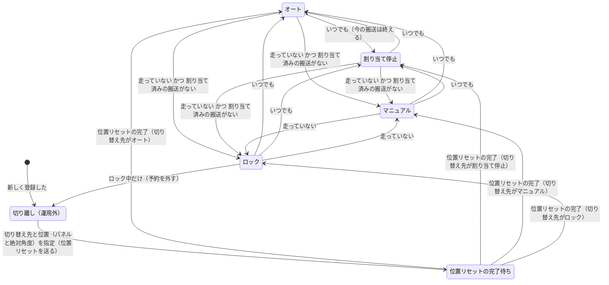

# B6. コントロールステータスの切り替え

AGV ごとに、システムがどこまで指示を出すかを表すコントロールステータスと、その切り替えの条件です。ユーザーが画面から切り替えます。

- 根拠：[domain.md](../domain.md)「コントロールステータス」、`src/FlowHub.Traffic/ControlStatus.cs`
- コントロールステータスは DB（`traffic.agvs`）に保存し、再起動しても残します。

- 「走っていない」は、待機中か緊急停止中のことです（走行の指示は取り消せないため、走っている途中の切り替えを制限します）。
- 切り離しから切り替えるとき、指定した位置のパネルを **ほかの AGV が予約していたら**、受け付けず、切り離しのままにします。
- 「位置リセットの完了待ち」は、切り離しから切り替える操作の途中を表すために、この図で描き加えたものです（コントロールステータスの値ではありません）。

## ステータスごとの扱い

| ステータス | システムの判断で指示を出すか | 新しい搬送の割り当て | 全台の計画での扱い |
|---|---|---|---|
| オート | 出す | する | 計画の中で動かす |
| 割り当て停止 | 出す | しない（今の搬送は終える） | 計画の中で動かす |
| マニュアル | 出さない（ユーザーがシステムを通してコマンドを送る） | しない | 今いるパネルと、ユーザーのコマンドで動いている先を塞いでいるものとして扱う |
| ロック | 出さない（ユーザーも指示しない） | しない | 今いるパネルを塞いでいるものとして扱う。予約も保つ |
| 切り離し | 出さない（どのコマンドも送らない） | しない | いないものとして扱う。予約も外す |

## ロック中に受け付けるコマンド

| コマンド | ロック中 |
|---|---|
| 緊急停止 | 受け付ける（どのステータスでも） |
| 位置リセット | 受け付ける |
| アラームクリア | 受け付けない（残りの指示の続きを走り出すため） |
| キャリアを上げる | 受け付けない（AGV が動くため） |

## 切り替えに伴うこと

- 緊急停止中の AGV を **マニュアルかロックに切り替えたら**、行き先と残りの経路を捨てます。充電ポートへ向かっていたなら、オートか割り当て停止に戻したときに、充電ポートを探し直します。
- マニュアル、ロック、切り離しの間に充電が必要になっても、充電ポートへは向かわせません。オートか割り当て停止に戻したときに向かわせます。
- コントロールステータスが変わったとき、塞がれて待っている AGV がいれば、全台の計画を立て直します。
