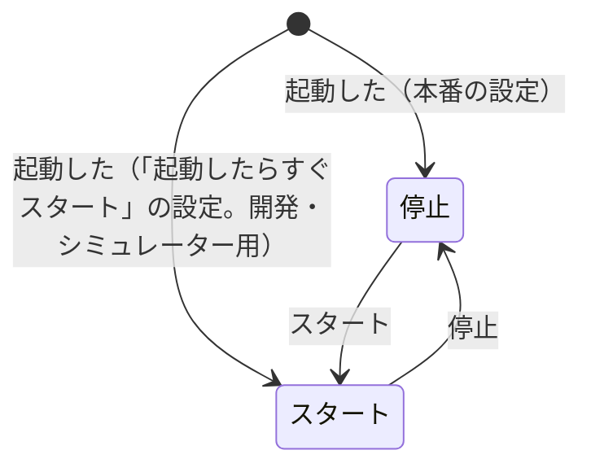
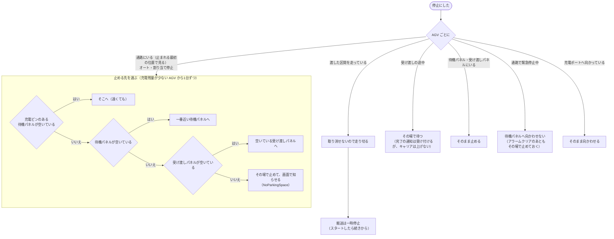
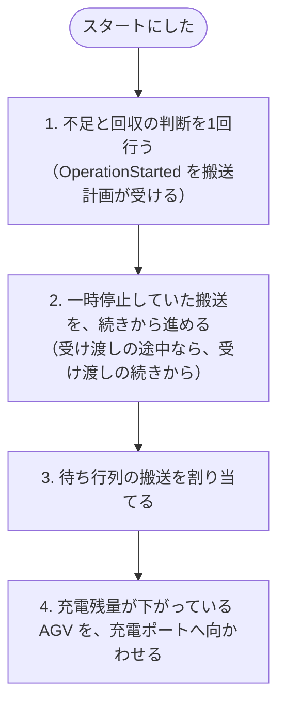

# B7. システムの運転状態（停止とスタート）

システム全体で持つ運転状態と、切り替えたときに行うことです。システムが自分の判断でコマンドを出すのは、スタートのときだけです。

- 根拠：[domain.md](../domain.md)「システムの運転状態」
- 運転状態は HTTP の窓口（`/system/start`、`/system/stop`、`/system/status`）から切り替えます。DB には保存しません。

## どちらの状態でも行うこと

- AGV・装置・ステーションからの通知（位置、完了、エラー）を受け付ける
- マニュアルのコマンドを出す
- 搬送の頼みを受け付けて、待ち行列に入れる（停止中は割り当てない）
- 割り当てたあとの搬送の取りやめを受け付ける（取りやめに要るコマンドは、停止中でも出す）

## 停止中に出さないもの

| 自動で出すもの | 担当 |
|---|---|
| 搬送を AGV に割り当てて、動かす（キャリアの上げ下げを含む） | 配車 |
| 充電残量が下がった AGV を、充電ポートへ向かわせる | 配車 |
| 通り道を塞いでいる AGV を、待機パネルへどかす | 交通整理 |
| 不足と回収を判断して、配車に搬送を頼む | 搬送計画 |
| 上位システムに補充を頼む | 搬送計画・消耗品の管理 |
| 装置・ステーションに受け渡しの許可を出す | 消耗品の管理 |

## スタートから停止にしたとき

- マニュアル・ロック・切り離しの AGV には触りません。異常や位置リセット待ちの AGV は、走れないので対象にしません。
- 待機パネルへ向かわせるのは **停止にしたときだけ** です。停止中にあとから通路で止まった AGV は、その場で止めておきます。
- 同じ近さの候補が複数あれば、パネルの ID の順に選びます。複数の AGV が取り合うときは、充電残量が少ない AGV から（わからない AGV は最後）、同じなら候補に一番近い AGV から、それも同じなら AGV の ID の順に決めます。

## 停止からスタートにしたとき

- 受け渡しパネルに止めた AGV に搬送がなければ、そのまま止まっています。その受け渡しパネルを使う搬送が来たら、通り道を塞いでいる AGV をどかす仕組みで、待機パネルへ動かします。
