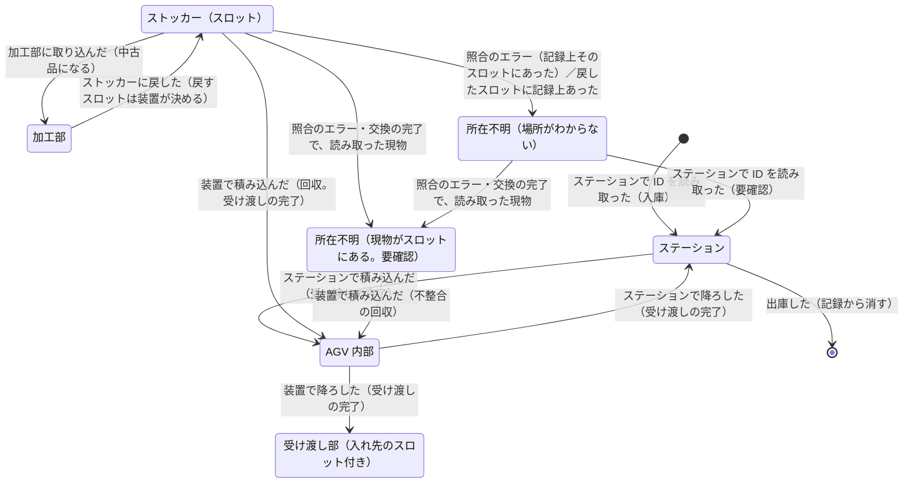

# B8. 消耗品の所在の遷移

1個の消耗品が、どの所在からどの所在へ、何をきっかけに移るかです。

- 根拠：[domain.md](../domain.md)「消耗品の所在（状態）」「消耗品の流れ」「ステーション」「装置から受け取る情報」「ID の照合が合わないとき」「消耗品の在庫管理」、`src/FlowHub.Consumables/Locations.cs`、`ConsumablesService*.cs`

## 仕様の流れ

仕様では、消耗品は次の経路をたどります。回収は、同じ経路を逆にたどります。

## 所在の状態遷移（今の実装）

- 「受け渡し部」から「ストッカー」へ移るきっかけ（装置からの知らせ）は、まだ決まっていません。今の実装では、装置で降ろした消耗品は **受け渡し部（入れ先のスロット付き）のまま** で、入れ先のスロットをふさぐものとして数えています。回収で装置から積み込むときも、受け渡し部を経ずに、ストッカーから AGV 内部へ直接移しています。受け渡し部にある消耗品を加工部に取り込んだという通知は、記録と食い違う通知として扱われます（通知を正として加工部にし、警告する）。未決事項 #23 で決めます。
- 装置・ステーションからの通知が記録と食い違うときは、**通知を正として** 所在を更新し、食い違いをログに残して画面で警告します（例：記録上ほかの場所にある消耗品を、ステーションで読み取った）。この図では、食い違いのときの遷移は省いています。
- 所在不明にした消耗品に搬送の予約が付いていたら、予約を解き、不足と回収の判断をやり直します。

## 所在とは別に持つ印

| 印 | 値 | 変わるとき |
|---|---|---|
| 新品か中古品か | 新品 → 中古品 | 加工部に取り込まれた時点で中古品にする。ステーションで人が直すこともある |
| 要確認 | 付く → 外れる | 付く：未登録の ID を読み取った、所在不明の消耗品をステーションで読み取った、照合のエラー・交換で現物がスロットにある。外れる：人がステーションで品種と新品・中古品を直した |
| 予約 | 届ける予約・回収の予約 | 搬送計画が搬送を頼むときに付け、取りやめ・所在不明・出庫で解く |
| 指名 | 装置への指名 | ユーザーが画面から指名する。割り当て前なら取り消せる。ステーションにある要確認でない新品でなくなったら自動で外れる |
