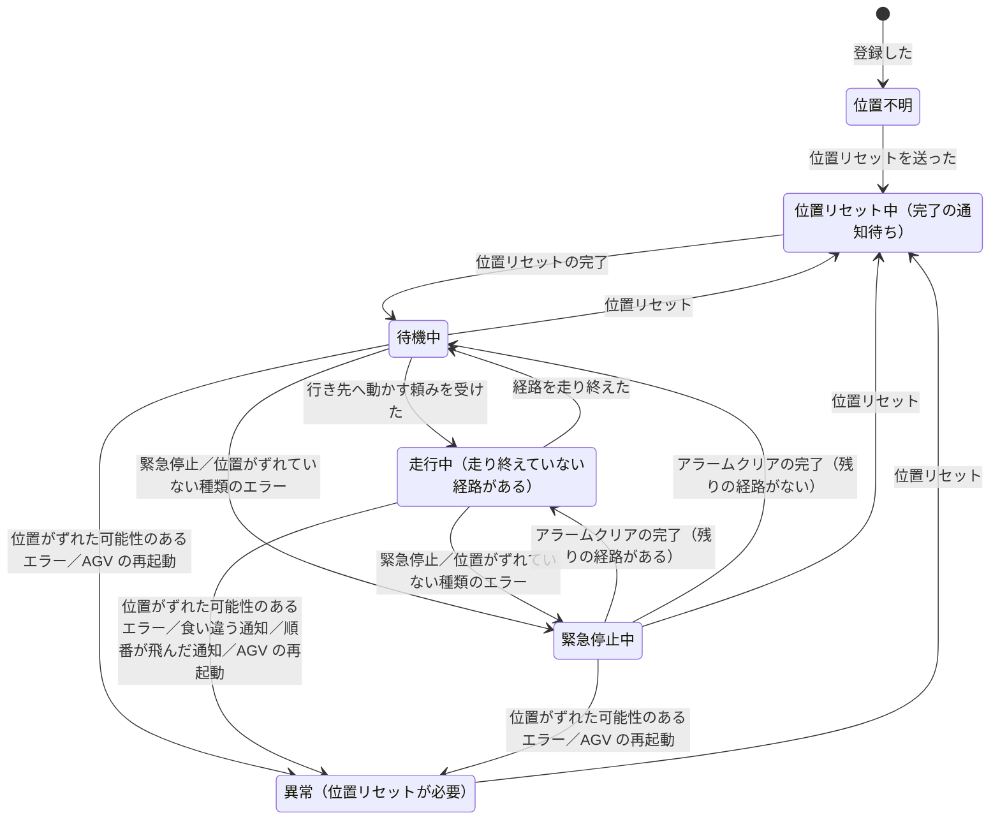
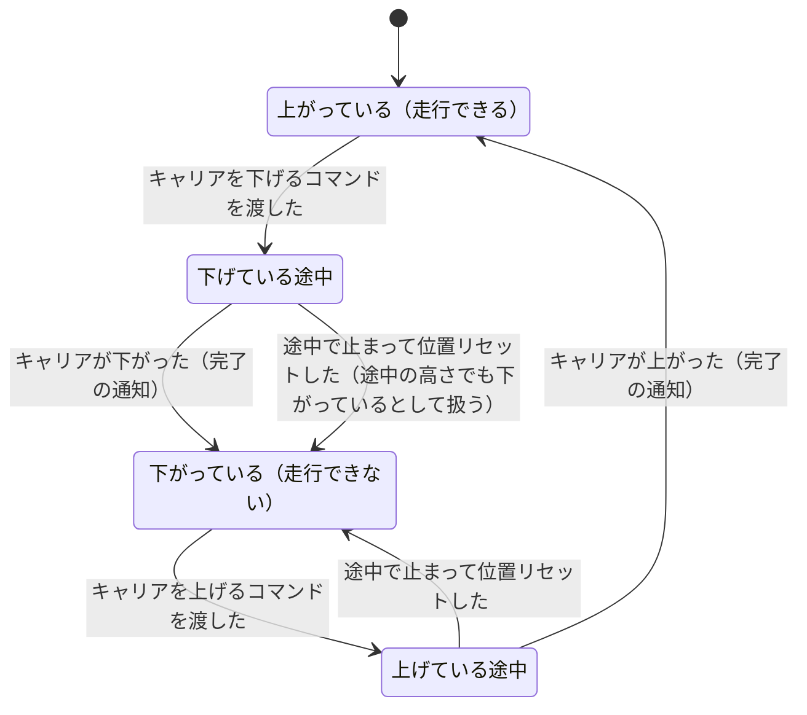
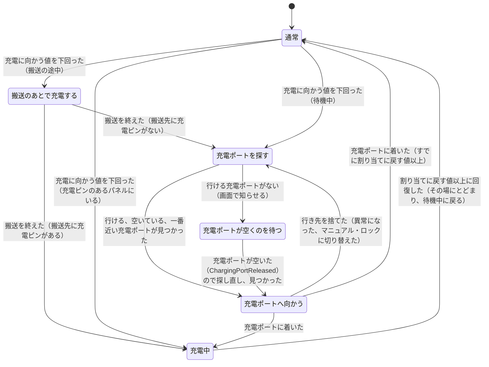

# B9. AGV の状態

交通整理が持つ AGV の走行の状態、キャリアの状態と、配車が持つ充電の状態です。3つは別々に持ち、組み合わせて判断します（例：キャリアが下がっている間は走らせない）。

- 根拠：[domain.md](../domain.md)「AGV からの完了の通知」「AGV のエラー」「予期しない通知の扱い」「緊急停止」「位置のリセット」「受け渡しの手順」「充電」、`src/FlowHub.Traffic/Domain/AgvTravel.cs`（`AgvTravelStatus`）、`AgvCommand.cs`（`CarrierState`）、`src/FlowHub.Dispatching/Domain/AgvCharging.cs`（`ChargingState`）

## 走行の状態（交通整理）

- **位置がずれた可能性のあるエラー**：十字の検出漏れ、十字の誤検出。**位置がずれていない種類のエラー**：バンパースイッチ、通信が切れた、充電切れ、モーターのドライバーのエラー、ハードウェアのエラー、サーバー要求エラー停止。
- **AGV の再起動** は、コマンドを取りに来る GET に `lastReceived=-1` が載ってきたことで知ります（初めて動かすときを除く）。走りかけの動作コマンドは渡し直さず、予約を保ったまま位置リセットを待ちます。
- **異常** のときは、緊急停止しても、位置がずれていない種類のエラーが届いても、異常のままです（アラームクリアで走り出せてしまうため）。予約は保ちます。
- **位置リセット** は、AGV が動作中（走行中やキャリアの上げ下げ中）なら受け付けません（先に緊急停止します）。指定したパネルをほかの AGV が予約していても受け付けません。
- 位置不明の AGV からエラーの通知が届いたら、ログに残すだけにします。
- 緊急停止で止まったとき、システムは AGV がどの2枚のパネルの間にいるかまでしかわかりません。止まっている間は、両側のパネルを使用中として扱います。

## キャリアの状態（交通整理）

- キャリアを下げられるのは、AGV が **受け渡しパネルにいて、待機中で、キャリアが上がっているとき** だけです。
- キャリアを上げられるのは、キャリアが下がっているときです。緊急停止中は先にアラームクリアが要ります。異常のときは、位置リセットのあとに上げます。
- 上げ下げの途中でエラーが起きたら、AGV はその場で止まり、アラームクリアで途中から再開します。

## 充電の状態（配車）

- 充電に向かう値（既定 20%）と、割り当てに戻す値（既定 80%）は、AGV の種類ごとに設定で変えられます。ちょうど充電に向かう値なら、割り当てます。
- まだ一度も充電残量の通知が来ていない AGV は、充電は足りているものとみなします。
- 運転状態が停止の間と、コントロールステータスがマニュアル・ロック・切り離しの間は、充電ポートへ向かわせません（スタート、またはオートか割り当て停止に戻したときに探させます）。
- 充電ポートを待っている AGV が複数いるときは、充電残量が少ない AGV から探させます（同じなら空いた充電ポートに近い AGV、それも同じなら AGV の ID の順）。
- 充電ピンのあるパネルに止まっている間は、状態にかかわらず充電されます。
