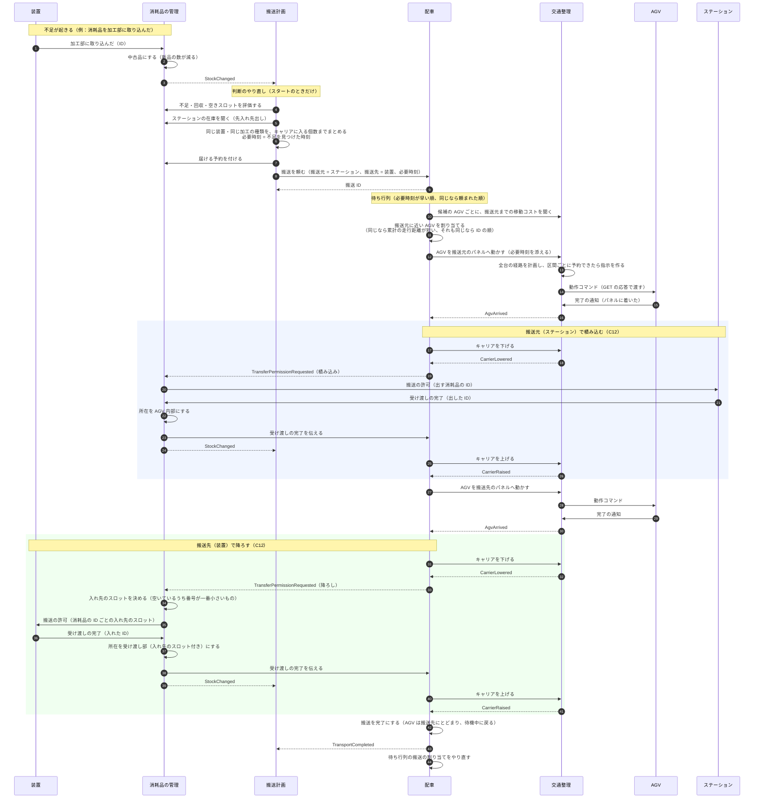

# C10. 消耗品を届ける流れ（全体）

装置で不足が起きてから、ステーションの消耗品が装置に届くまでの、コンテキストをまたぐ流れです。回収するときも同じ流れで、搬送元と搬送先が入れ替わります（装置で積み込み、ステーションで降ろします）。

- 根拠：[domain.md](../domain.md)「装置のストッカー」「判断のやり直し」「搬送の要求のまとめ方」「AGV の割り当て」「搬送の流れ」「受け渡しの手順」、各コンテキストの `Application` の層
- 実線の矢印は呼び出し、点線の矢印はイベントと応答です。AGV とのやり取りは [C11](11-agv-communication.md)、受け渡しの細かい手順は [C12](12-handover.md) にあります。

## 補足

- ステーションに必要な数の一部しかないときは、あるぶんを先に届け、残りは上位システムに補充を頼みます（頼む数 = 足りない数 − まだ入庫されていない数。1以上のときだけ）。
- ストッカーに空きがないときは、空きの数までしか届ける要求を出さず、残りは回収が終わってから出します。
- 判断をやり直すたびに、**割り当て前の要求はすべていったん取りやめて出し直します**（必要時刻は保ちます）。割り当てたあとの要求は、まるごと要らなくなったときだけ取りやめます（[C13](13-cancel-after-assignment.md)）。
- 空いているスロットが降ろす数より足りないときは、許可を出さずにエラーにし、画面で知らせます（搬送は受け渡し待ちのまま止まります）。
- 受け渡し部からストッカーへ入ったことの知らせは、まだ決まっていません（未決事項 #23）。
