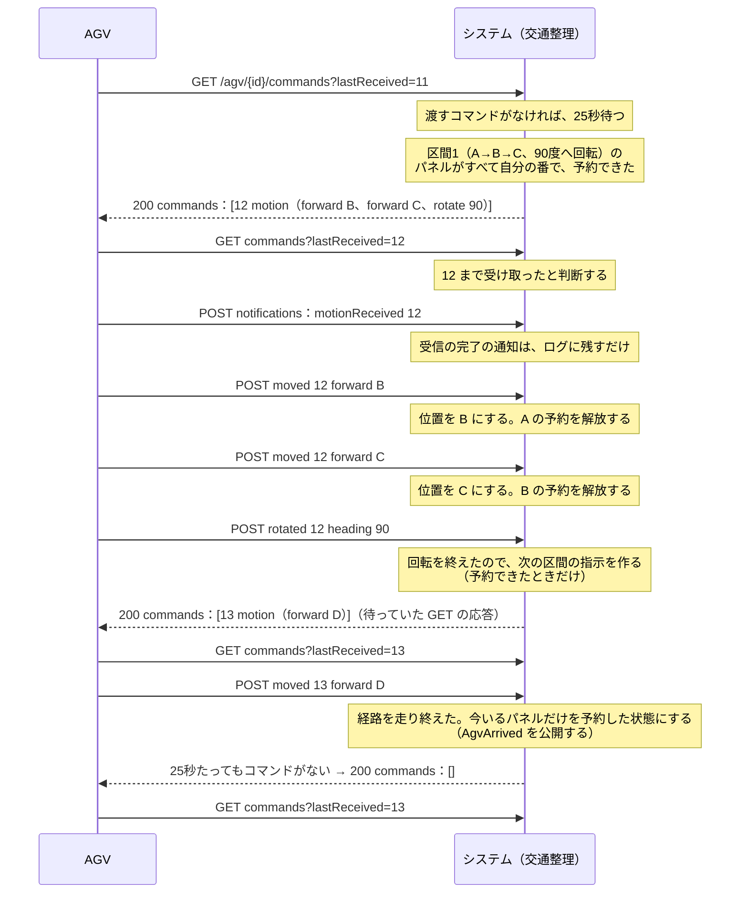
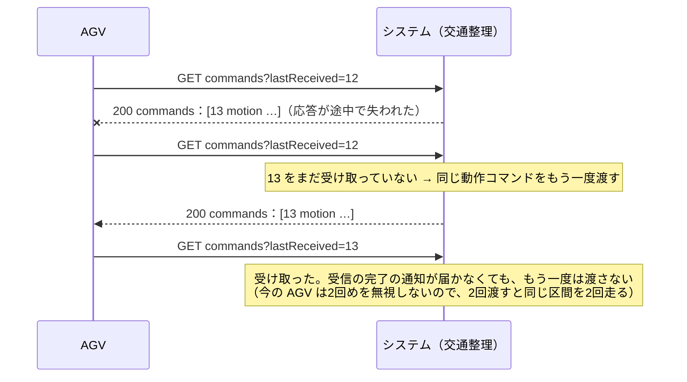
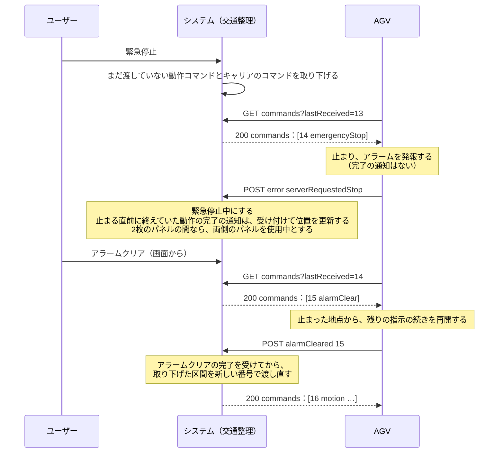
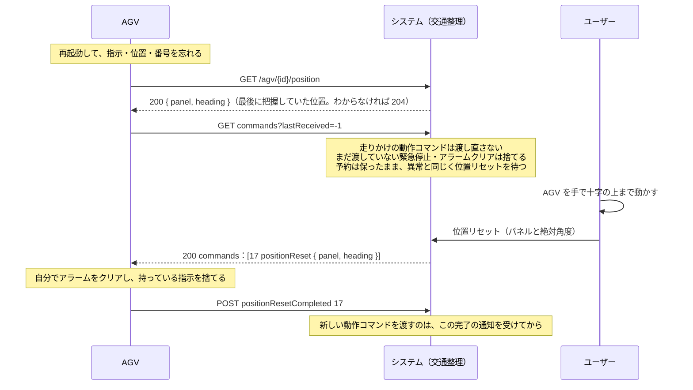

# C11. AGV との通信

システム（交通整理）と AGV の間のやり取りです。AGV がシステムへリクエストを送るだけで、システムから AGV へ直接送る経路はありません。

- 根拠：[agv-protocol.md](../agv-protocol.md)、[domain.md](../domain.md)「動き方と走行の指示」「AGV との通信（コマンドの受け渡し）」「AGV からの完了の通知」「指示の番号」「予期しない通知の扱い」「動作コマンドの受信の確認」「緊急停止」「まだ AGV に渡していないコマンドの取り下げ」
- 窓口：`src/FlowHub.Traffic/Infrastructure/AgvEndpoints.cs`

## 区間ごとの走行（ふだんの流れ）

例：A → B → C と前進し、90度へ回転してから、D へ前進する経路。区間は回転で区切ります。

- 前進・後退の1つ1つは、**次の十字のラインまでの距離と、移動先のパネル** です。AGV はマップを持たず、この情報と十字の検出から、今いるパネルを推測します。
- 番号は AGV ごとに1つずつ増やし、すべてのコマンド（動作、緊急停止、アラームクリア、位置リセット、キャリアの上げ下げ）で1つの通し番号を共有します。システムを再起動しても続きから数えます（DB の `traffic.command_numbers`）。

## 受け取ったかの確認（応答が失われたとき）

## 緊急停止とアラームクリア

## AGV が再起動したとき

## 予期しない通知の扱い

| 種類 | 見分け方 | 扱い |
|---|---|---|
| 重複して届いた通知 | 直前に受け付けた通知と、番号・動作の種類・パネルの ID がすべて同じ | 無視してログに残す（応答は 204） |
| 古い通知 | 位置リセットで捨てた指示の通知、走り終えた動作コマンドの番号 | 無視してログに残す |
| 実際の状態と食い違う通知 | 今の指示の番号なのに、指示と違うパネルに着いた | **異常** にする（緊急停止を送り、位置リセットを待つ） |
| 順番が飛んだ通知 | 次に着くはずのパネルではなく、その先の予定のパネル | **異常** にする |
| 意味のわからない通知 | 送っていない番号、知らない種類、壊れた内容 | 受け付けずにログに残す（壊れた内容は 400） |
| 予期しないアラームクリア・位置リセットの完了 | そのコマンドを送っていない | 無視して、ログに残し、画面で警告する |
