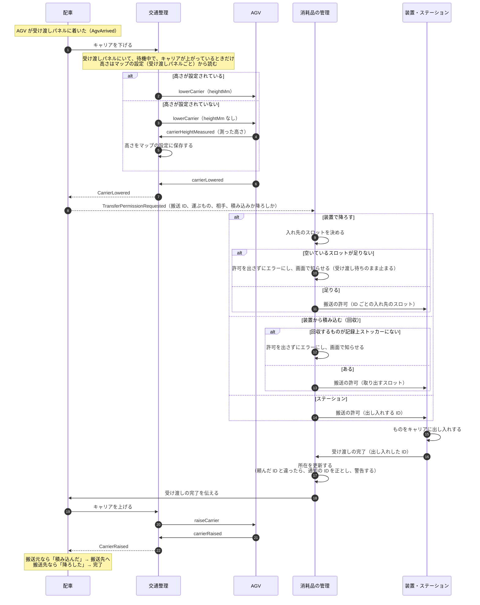

# C12. 受け渡しの手順

受け渡しパネルで、AGV と装置（またはステーション）がものを受け渡す手順です。届けるときと回収するときで手順は同じで、ものの向き（キャリアから相手へ、相手からキャリアへ）が逆になるだけです。

- 根拠：[domain.md](../domain.md)「受け渡しの手順」「装置のストッカー」、`src/FlowHub.Dispatching/Domain/Transport.cs`、`src/FlowHub.Consumables/Gateways.cs`

## 途中で止まったとき

| 起きたこと | 扱い |
|---|---|
| キャリアを下げている間に緊急停止・エラー | AGV はその場で止まる。ユーザーはキャリアを上げられない。アラームクリアのあと、システムが上げるコマンドを送る（取り下げたキャリアのコマンドは、新しい番号で渡し直す） |
| 上げ下げの途中でエラー | AGV はその場で止まる。アラームクリアで途中から再開する |
| 異常（位置リセットが必要）のとき | アラームクリアはできないので、位置リセットのあとに上げる（位置リセットでキャリアの状態は保たれる） |
| 搬送が一時停止中（緊急停止中、運転状態が停止） | 届いた知らせで段階は進めるが、次のコマンドも、受け渡しの相手への搬送の許可も出さない（AGV が止まっている間に、装置がものを出し入れしないようにするため） |
| 装置・ステーションが受け渡しを終えない | 待ち続ける（時間を区切るかは未決事項 #10「異常時の扱い」で決める） |
| 受け渡しの途中で取りやめ | 許可をまだ出していなければ、許可を出さずに上げる。出したあとなら、受け渡しを最後まで終えて上げる（搬送先なら完了として扱う） |

- キャリアを下げている間は、走行できません。システムはキャリアが上がるまで AGV を走らせません。
- 特殊消耗品受け渡しパネルでは、キャリアを下ろす角度を向いているときだけ下げられます（搬送で向かうときは、着いたら `rotate_special` でその角度へ回ってから止まります）。
