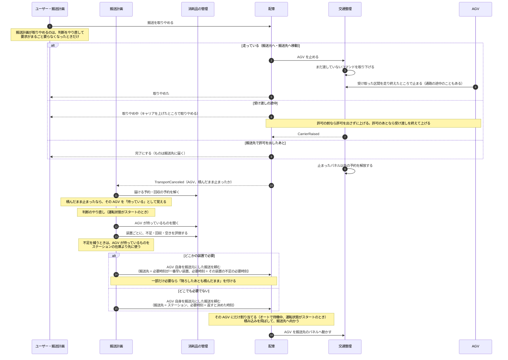
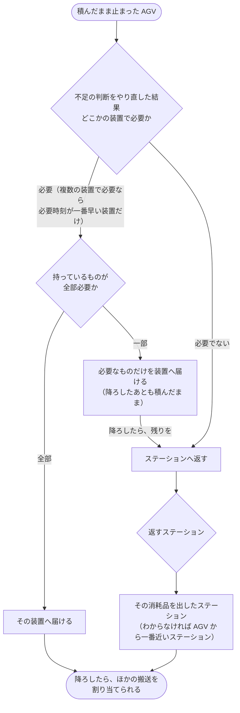

# C13. 割り当てたあとの搬送の取りやめ

AGV を割り当てたあとの搬送を、AGV へのコマンドの単位で取りやめる流れです。積み込んだあとに取りやめたときは、AGV が持っているものを、必要な装置へ届けるか、ステーションへ返します。

- 根拠：[domain.md](../domain.md)「搬送の流れ」「判断のやり直し」、`src/FlowHub.Dispatching/Domain/Transport.cs`、`src/FlowHub.ToolPlanning/Application/ToolPlanningService.cs`
- 段階ごとの取りやめの結果は [B5. 搬送の状態遷移](05-transport-state.md) にあります。

## 取りやめから、持っているものの行き先を決めるまで

## 持っているものの行き先

- 返すステーションの選び方は、ステーションの選び方のルール（未決事項 #5）が決まるまでの扱いです。
- 持っているものを届けるか返すまで、その AGV にほかの搬送は割り当てません。割り当て停止の間も、その AGV へは割り当てません。
- その AGV を搬送元にした搬送は、1つだけ受け付けます。積んだまま止まっていない AGV を搬送元にした頼みは、受け付けません。
- 運転状態が停止の間も、取りやめは受け付けます（取りやめに要るコマンドは、停止中でも出します）。
