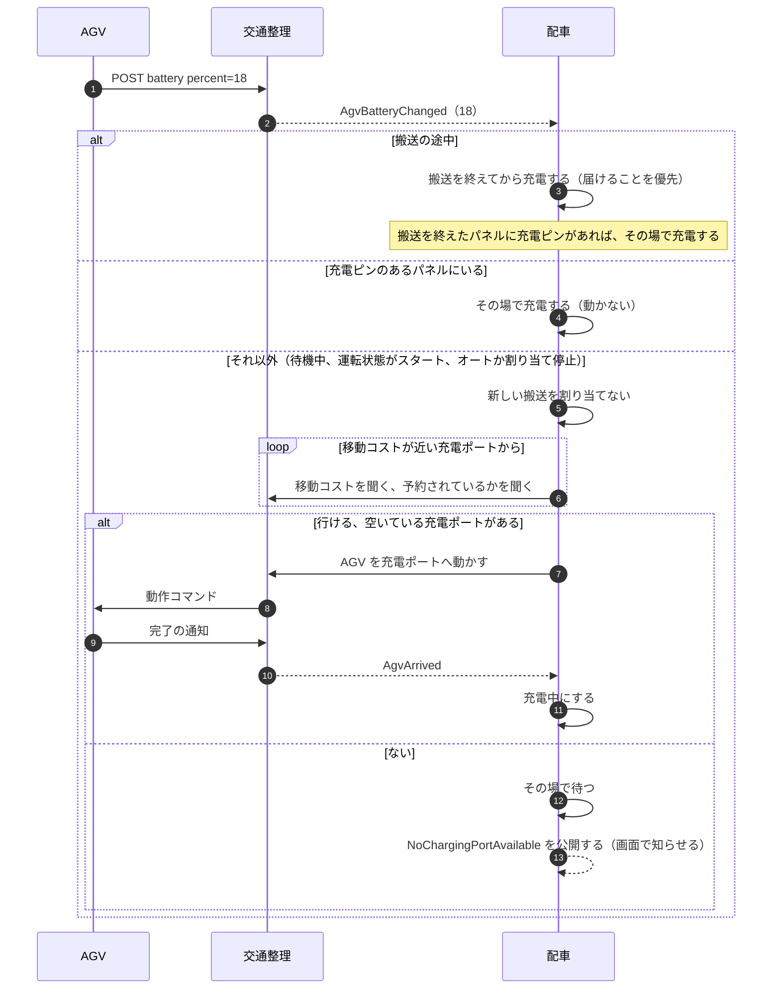
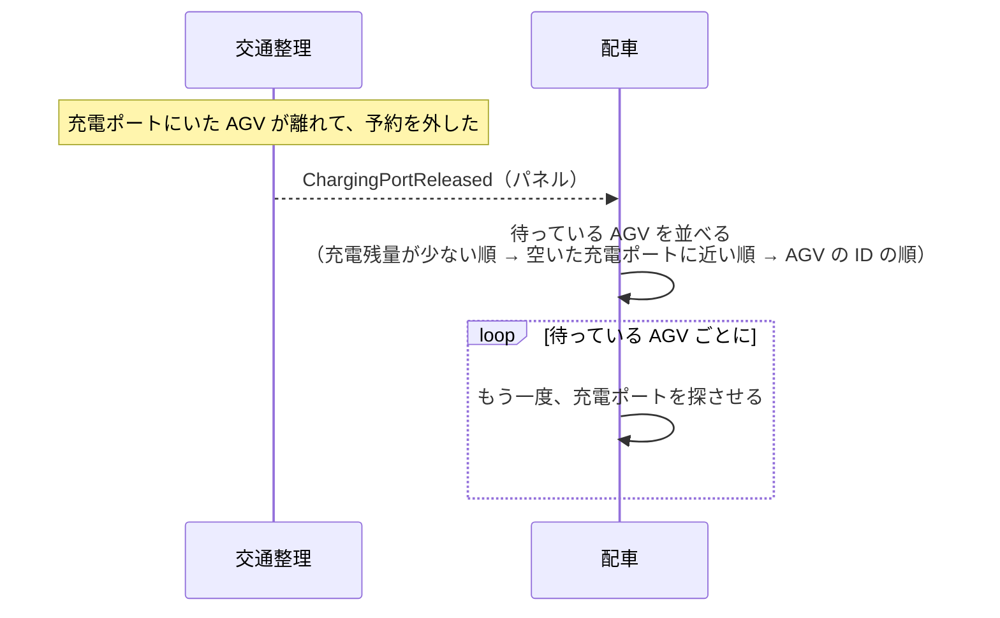
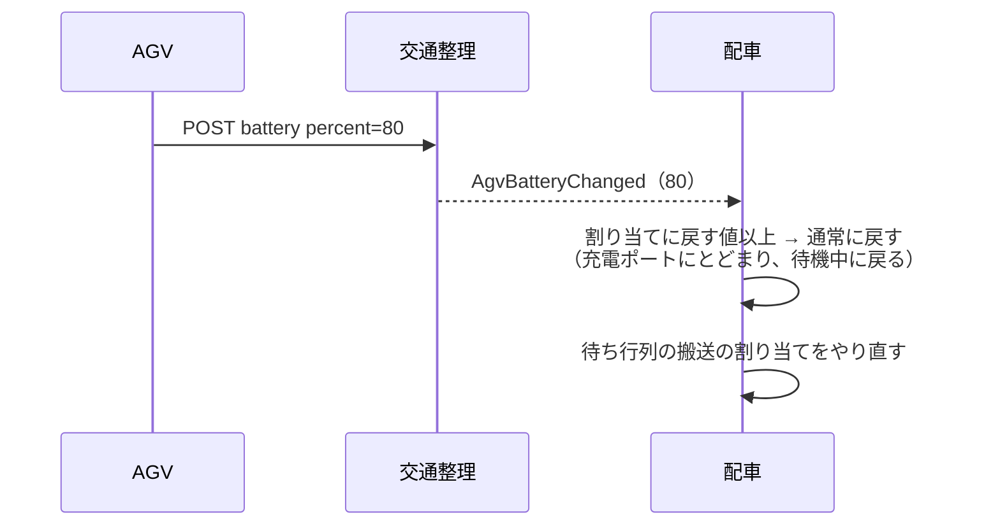

# C14. 充電

充電残量の通知から、充電ポートへ向かい、割り当てに戻るまでの流れです。充電に行かせるかの判断は配車が、充電ポートまで動かすのは交通整理が受け持ちます。

- 根拠：[domain.md](../domain.md)「充電」「AGV の割り当て」、`src/FlowHub.Dispatching/Domain/AgvCharging.cs`
- 充電の状態の遷移は [B9. AGV の状態](09-agv-state.md) にあります。

## 充電ポートへ向かう

- ほかの AGV が使っている（予約している）充電ポートと、ほかの AGV が向かっている充電ポートは、使っているものとみなします。
- 充電ポートは、充電ピンを設置した受け渡しパネルか待機パネルです。

## 充電ポートが空いたとき

## 割り当てに戻る

## 決まりごと

| 項目 | 内容 |
|---|---|
| 充電に向かう値 | 既定 20%。これを **下回ったら** 向かう（ちょうどなら割り当てる） |
| 割り当てに戻す値 | 既定 80%。これ **以上** に回復したら戻す |
| 値の持ち方 | システム全体の既定値と、AGV の種類ごとの値（省略したら、登録したときの既定値で埋めて保存）。割り当てに戻す値は、充電に向かう値以上 |
| 通知が来ていない AGV | 充電は足りているものとみなす |
| 向かう途中で回復した | 向かうのはやめず、着いてから判断する |
| 向かう途中で異常になった | 「充電ポートを探す」に戻し、位置リセットが完了して待機中になったら、もう一度探す |
| 運転状態が停止 | 向かわせない。スタートしたときに探させる |
| マニュアル・ロック・切り離し | 向かわせない。オートか割り当て停止に戻したときに探させる |
