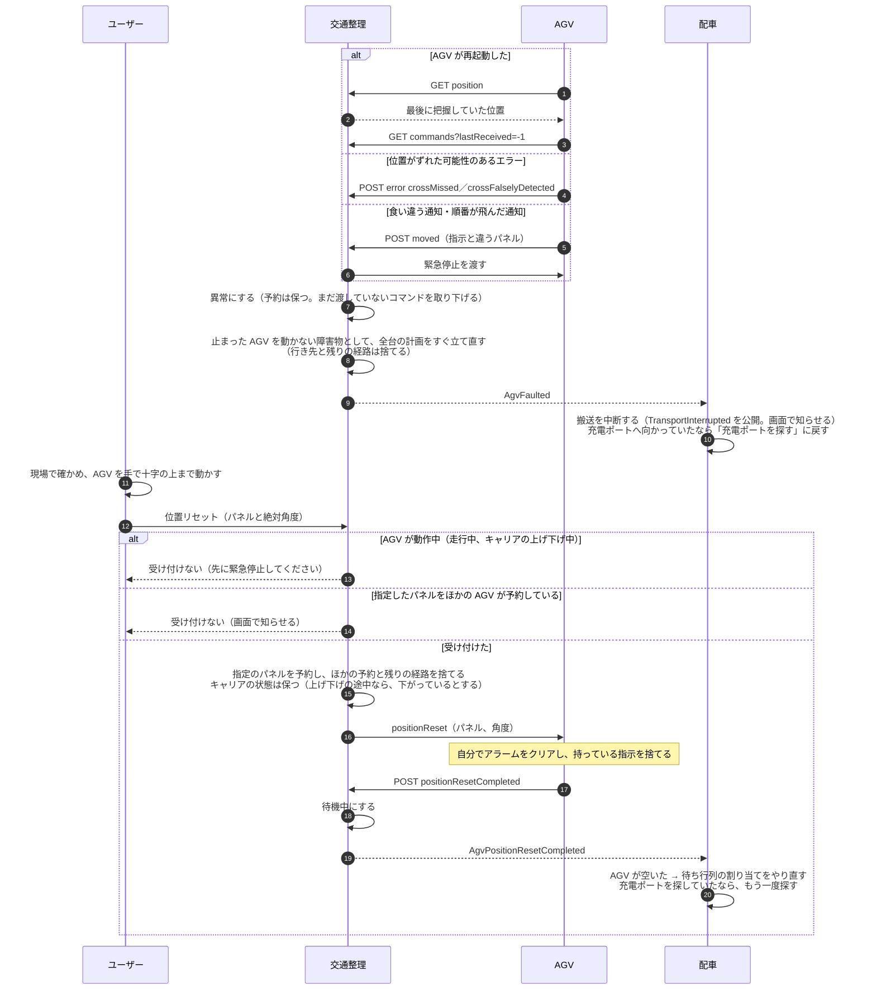
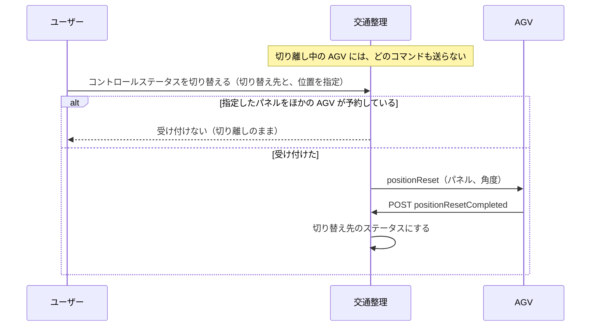

# C15. AGV が再起動したとき・位置リセット

AGV が再起動したときや、異常（位置がずれた可能性がある）になったときに、ユーザーが位置リセットで復旧させる流れです。

- 根拠：[domain.md](../domain.md)「AGV からの完了の通知」「AGV のエラー」「位置のリセット」「まだ AGV に渡していないコマンドの取り下げ」「コントロールステータス」「全台の経路の計画」
- AGV との通信の細かい形は [C11. AGV との通信](11-agv-communication.md) にあります。

## 異常から位置リセットで戻るまで

- 位置リセットの完了の通知を受けるまでは、新しい動作コマンドを渡しません。
- 「異常」はアラームクリアでは戻れません。システムが AGV の本当の位置を見失っているため、予約していないパネルに AGV がいて、ほかの AGV とぶつかるおそれがあるからです。
- 異常のときに届いた完了の通知は、番号と中身が指示と合っていれば受け付けて位置を更新しますが、異常は解除しません。後ろのパネルの予約も解放しません。
- 中断した搬送を、位置リセットのあとにやり直すか取りやめるかを選ぶ仕組みは、まだ実装していません（[backlog.md](../backlog.md) #8、未決事項 #10）。

## 切り離しから戻すとき

