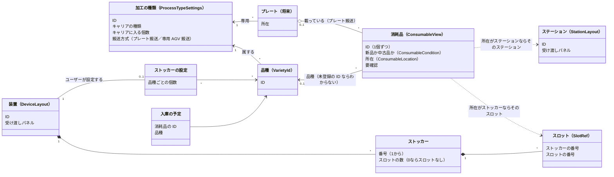
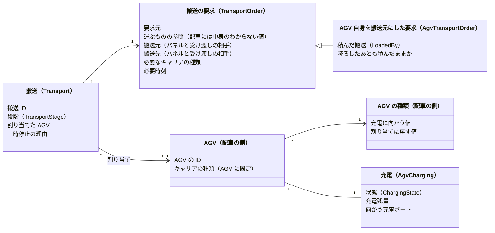
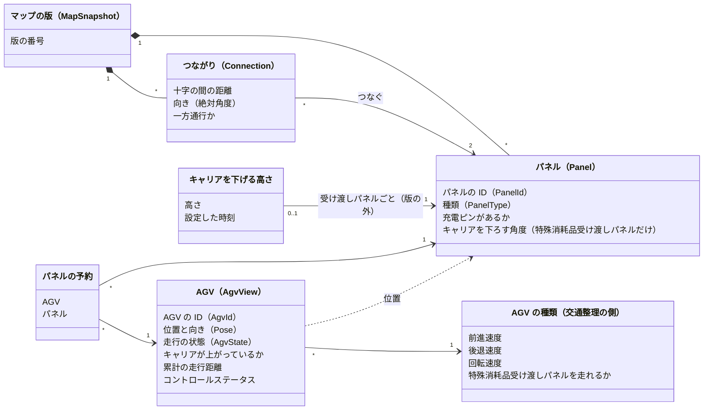

# D16. ドメインモデル（クラス図）

ドメインの概念と、その関係です。コンテキストごとに分けて描いています。クラスの名前は、コードの型の名前に合わせています（行は DB のテーブルではなく、概念です。DB は [D18](18-db-schema.md) にあります）。

- 根拠：[domain.md](../domain.md)「消耗品」「消耗品の搬送方式」「ステーション」「装置のストッカー」「AGV の割り当て」「充電」「パネルとマップ」、各コンテキストの公開の型

## 消耗品の管理

- 互換性は **品種の中だけ** です。同じ品種なら、どの ID の消耗品を送ってもかまいません。
- 1つのスロットに置けるのは1個です。プレートに載ったまま置く装置のストッカーには、スロットがありません。
- 入庫の予定（ID と品種の対応）は、上位システムか人が前もって登録します。ステーションで読み取った ID がここにあれば、その品種の新品として入庫します。

## 配車

- 配車は、運ぶもの（消耗品やワーク）を知りません。運ぶものは、要求元が渡す参照（文字列）としてだけ持ちます。
- AGV は、交通整理（速さ）と配車（キャリアの種類、充電の設定値）の両方に登録します。

## 交通整理とマップ

- マップは、変更できないスナップショット（版）として公開します。キャリアを下げる高さは、たびたび変わるので版の外に持ちます。
- 1枚のパネルを予約できるのは、1台の AGV だけです。

## コンテキストをまたぐ参照

| 参照する側 | 参照するもの | 持ち方 |
|---|---|---|
| 消耗品の管理（装置、ステーション） | マップのパネル | `PanelId` |
| 消耗品の管理（所在が AGV 内部） | 配車の搬送 | `TransportId` |
| 搬送の要求 | 受け渡しの相手（装置・ステーション） | 中身のわからない文字列（`Endpoint`） |
| 配車 | 交通整理の AGV | `AgvId` |
