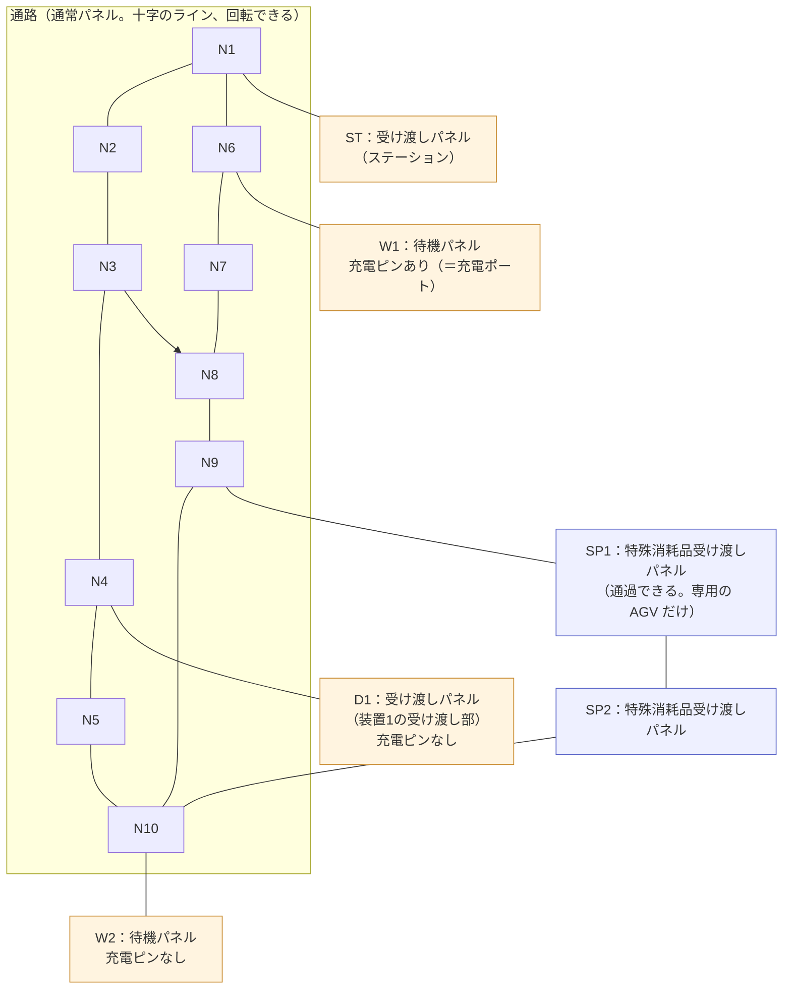
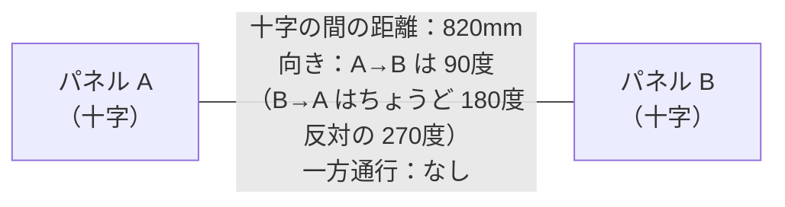
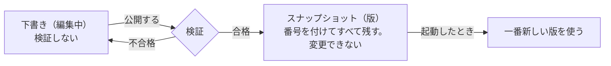

# D17. マップの構造

パネル、パネルの種類、つながりと、ステーション・装置の受け渡し部・充電ポートの置かれ方です。

- 根拠：[domain.md](../domain.md)「パネルとマップ」「パネルの種類」「特殊消耗品受け渡しパネル」「経路の求め方」「充電」、`src/FlowHub.Map`

## マップの配置の例

下の配置は、説明のための **例** です（実際の配置は現場ごとに、装置の設置状況に合わせて決めます）。矢印のない線は双方向のつながり、矢印は一方通行です。

- 受け渡しパネルと待機パネル（オレンジ）は **行き止まり** です。隣り合う通常パネルは1枚だけで、**前進でのみ入り、後退でのみ出ます**。中では回転できないので、入る前に隣のパネルで向きを合わせます。止まっている AGV は、ほかの AGV の通行をふさぎません。
- 行き止まりのパネルへのつながりは、一方通行にできません。行き止まりのパネルの隣は通常パネルだけで、特殊消耗品受け渡しパネルのすぐ隣には置けません。
- 特殊消耗品受け渡しパネル（青）は行き止まりではなく、並べて設置でき、通過できます。

## パネルの種類

| 種類（`PanelType`） | 入り方 | 出方 | 回転 | 充電ピン | 走れる AGV |
|---|---|---|---|---|---|
| 通常パネル | 制限なし | 制限なし | できる | 設置できない | すべて |
| 受け渡しパネル | 前進でのみ | 後退でのみ | できない | 設置できる | すべて |
| 待機パネル | 前進でのみ | 後退でのみ | できない | 設置できる | すべて |
| 特殊消耗品受け渡しパネル | 制限なし | 制限なし | できる | 設置できない | 走れると設定した種類の AGV だけ |

- 「充電ポート」は独立した設備ではなく、**充電ピンを設置した受け渡しパネルか待機パネル** のことです。
- ステーション、装置の受け渡し部、充電ポートは、それぞれ特定のパネルの上にあります。

## 2枚のパネルの間（つながり）

- パネルは格子状にすき間なく並びますが、ラインを引き直す場所があるので、**十字の間の距離はつながりごとに持ちます**。
- ラインが斜めのこともあるので、**向きは絶対角度** で持ちます（0・90・180・270度に限りません）。ラインはまっすぐなので、逆向きはちょうど 180度反対です。
- 同じ2枚のパネルの間のつながりは、1本だけです（向きが逆でも同じつながりとみなします）。
- 一方通行は、AGV の向きではなく **実際に動く方向** で決まります。後退でも逆向きには通れません。

## 版と検証

| 検証すること | 既定 |
|---|---|
| それぞれの島の中で、一方通行も守ったうえで、どのパネルからどのパネルへも行ける | 常に |
| すべてのパネルが1つにつながっている（離れ島を許さない現場向け） | オフ |
| 特殊消耗品受け渡しパネルに、キャリアを下ろす角度が設定されている。充電ピンが設置されていない | 常に |
| ほかの種類のパネルに、キャリアを下ろす角度が設定されていない | 常に |

- キャリアを下げる高さは、版の外に、受け渡しパネルごとの設定として持ちます（たびたび変わり、経路や予約に関係しないため）。手入力と AGV の自動測定のうち、新しく設定されたほうを使います。
- 版を切り替えるタイミングは、マップの編集に取りかかるときに決めます。マップの編集と下書きの保存は、まだ実装していません（[backlog.md](../backlog.md) #5）。
