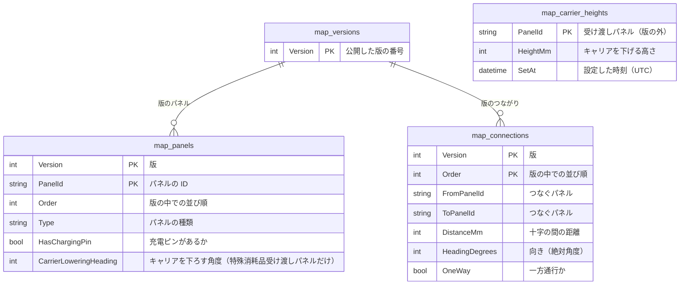
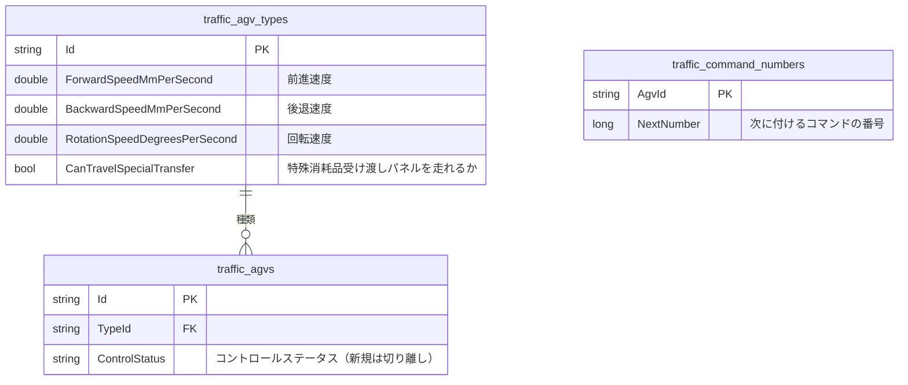
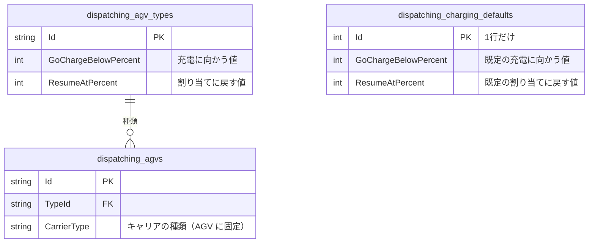
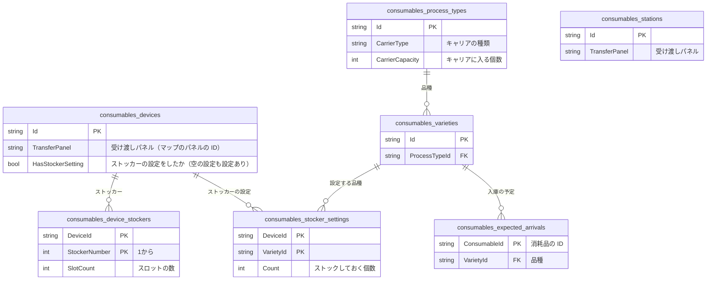

# D18. DB のスキーマ（ER 図）

コンテキストごとの DB のテーブルです。PostgreSQL ではコンテキストごとにスキーマを分け、SQLite ではコンテキストごとに別のファイル（`スキーマ名.db`）にします。ほかのコンテキストのテーブルは直接読みません。

- 根拠：[CLAUDE.md](../../CLAUDE.md)「ルール」、各コンテキストの `Infrastructure/*DbContext.cs`
- 今 DB に保存しているのは、**構成のデータ**（マップ、AGV と種類、装置・ステーション・品種など）と、再起動しても残す必要のあるもの（コマンドの番号、コントロールステータス）だけです。消耗品の在庫と所在、搬送、予約、運転状態はメモリーに持ち、再起動すると消えます（再起動したときの状態の復元は、未決事項 #14「非機能要件」）。
- 図の中のテーブル名は「スキーマ名_テーブル名」で書いています（例：`map_panels` は、スキーマ `map` のテーブル `panels`）。列の名前は、DB の実際の名前（プロパティの名前と同じ）です。

## map（マップ）

## traffic（交通整理）

## dispatching（配車）

## consumables（消耗品の管理）

## コンテキストをまたぐ値

外部キーは、同じスキーマの中にだけ張ります。ほかのコンテキストのものは、ID の値として持つだけです。

| 列 | 指しているもの |
|---|---|
| `consumables.devices.TransferPanel`、`consumables.stations.TransferPanel` | マップのパネルの ID |
| `traffic.agvs.Id` と `dispatching.agvs.Id` | 同じ AGV（両方に登録する。片方にしかない AGV は、起動したときにログに残して画面で知らせ、両方にある AGV だけで動かす） |
| `dispatching.agvs.CarrierType` と `consumables.process_types.CarrierType` | キャリアの種類 |
