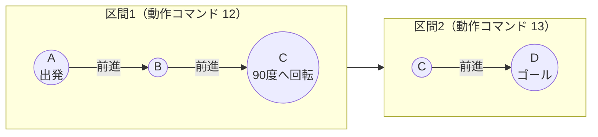
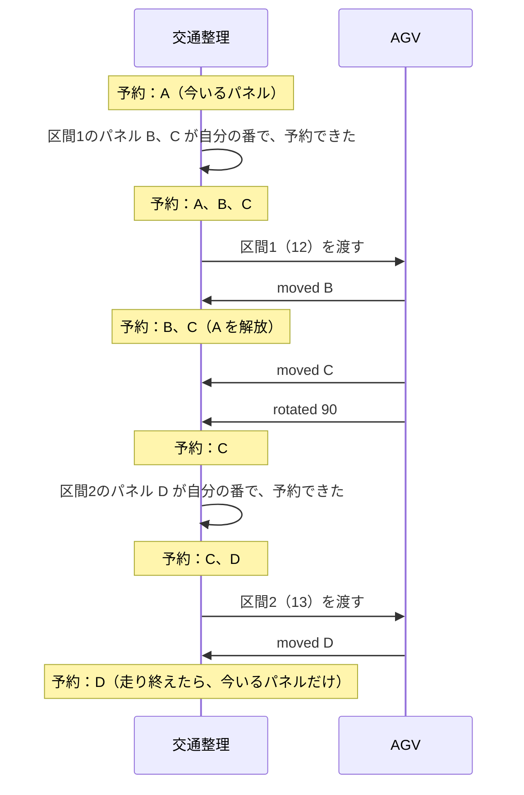
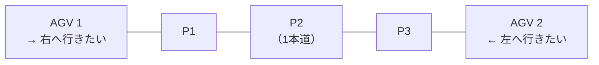
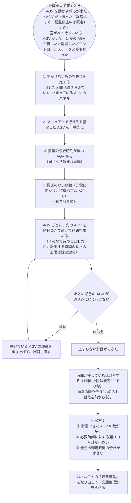

# D19. 交通整理の仕組み（予約、通る順番、デッドロックの防止）

AGV 同士の衝突とデッドロックを、どう防ぐかです。

- 根拠：[domain.md](../domain.md)「動き方と走行の指示」「衝突の防止」「デッドロックの防止」「全台の経路の計画」、`src/FlowHub.Traffic/Domain`（`PanelReservations`、`PassingOrderGate`、`TravelSection`）、`src/FlowHub.PathPlanning`
- **安全（衝突の防止）は、ルーティングに頼りません。** 交通整理が、区間のパネルを **すべて予約できたときだけ** 走行の指示を出すことで守ります。ルーティングと全台の経路の計画は、効率とデッドロックの防止に関わります。

## 区間と予約

指示は取り消せないので、ゴールまでを一度に出さず、**回転で区切った区間** ごとに出します。区間のパネルを予約できたときだけ、その区間を AGV に渡します。

- 予約は、十字の検出（完了の通知）をきっかけに、通過したパネルから順に解放します。ただし、同じ経路の中で、あとでもう一度通るパネルは解放しません（例：A → B → C → B → D なら、C に着いても B は手放しません）。
- 1枚のパネルに AGV は1台だけです。隣り合うパネルに停車しても、回転しても、隣にはみ出さないので、これで停車中・回転中の衝突は起きません。
- 区間は回転で区切ります。前進と後退が切り替わるところでも区切ります。ゴールに着く最後の区間は、回転で終わらないこともあります。

## なぜ予約だけではデッドロックするか

指示は取り消せず、AGV は自分では避けられません。予約済みを優先するだけだと、1本道で向かい合ったときに、どちらも進めなくなります。

- AGV 1 が P1 まで、AGV 2 が P3 まで予約して進むと、どちらも P2 の先へ進めず、止まったままになります。
- このため、**全台の経路の計画** で、パネルごとの「通る順番」を決めて守らせます。上の例なら「P2 は AGV 1 が先、AGV 2 があと」と決め、AGV 2 は P2 の手前の、すれ違える場所で AGV 1 が通り過ぎるのを待ちます。

## 全台の経路の計画

- 計画は `FlowHub.PathPlanning`（状態を持たない計算）が立て、交通整理が、AGV の位置、渡した指示、止まっている AGV などを引数で渡して呼びます。
- 計画と実際の動きがずれても、時刻ではなく **パネルごとの通る順番** を守らせます。遅れた AGV がいても、ほかの AGV は待つだけで、順番が守られるので、デッドロックしない計画なら、実際もデッドロックしません。
- 次の区間のパネルが **すべて自分の番になっていて**（先に通る予定の AGV が通り終えていて）、**予約できたときだけ**、その区間を渡します。

## 計画が立てられないとき

| 原因（塞いでいる AGV を取り除いても経路がないか、で見分ける） | 扱い |
|---|---|
| マップの上に、そもそも経路がない（別の島、一方通行で行けない） | 頼みを受け付けず、画面で知らせる（搬送の途中なら中断） |
| 今は、ほかの AGV に塞がれていて行けない | その場で待ち、画面で知らせる（`MoveBlocked`）。計画を立て直すたびに試す |

## 計画の中での AGV の扱い

| AGV | 扱い |
|---|---|
| 止まっている（待っている）・その場で回転している | そのパネルを使う |
| 隣のパネルへ前進・後退している | 出発したパネルと着くパネルの両方を使う |
| 行き先に着いた・行き先がない | 次の頼みまで、そのパネルに止まり続ける（あとの AGV は、その時刻から先は通れない） |
| 通り道を塞いでいて、動かせる | 移動コストが一番近い、空いている待機パネルへ動かす計画も一緒に立てる（同じ近さならパネルの ID の順） |
| 動かせない（充電中、ほかの頼みを受けている、キャリアが下がっている、など） | 動かない障害物 |
| 異常 | 動かない障害物。行き先と残りの経路を捨てる |
| 緊急停止中 | まず待つ。既定1分たっても再開しなければ、動かない障害物として立て直す。行き先は覚えておく |
| マニュアル（1つずつの動作） | 通る順番には従わず、予約だけで守る。ほかの AGV は、その予約を避けて計画し直す |
| ロック | 今いるパネルを塞いでいるもの |
| 切り離し | いないもの |

## 保険（まだ実装していない）

全台の計画を守らせれば、理屈の上ではデッドロックは起きません。それでも、計画の不具合や計画の外で動く AGV に備えて、どの AGV がどの AGV を待っているか（待ちのグラフ）を見張ります。待ちが輪になったら、画面で知らせて計画を立て直し、解けなければ1台を待機パネルへ逃がします。通路ごとの一方通行（設定で選べる）と合わせて、[backlog.md](../backlog.md) #1 にあります。どの AGV を逃がすかは未決事項 #15 です。
