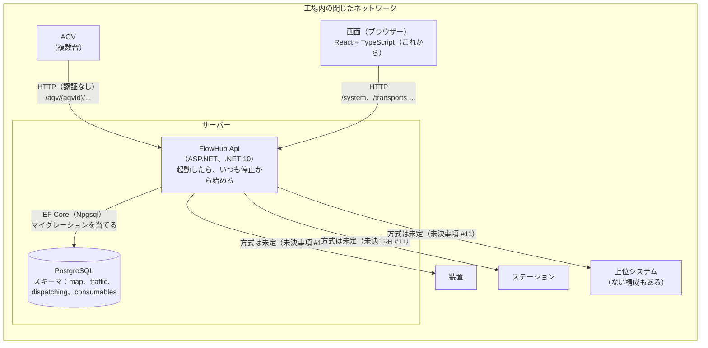
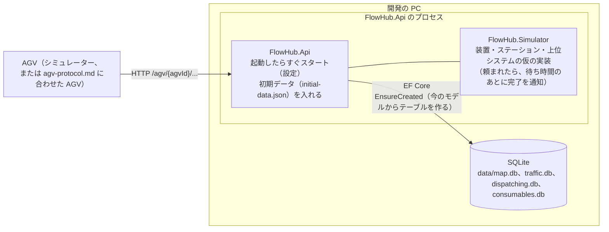
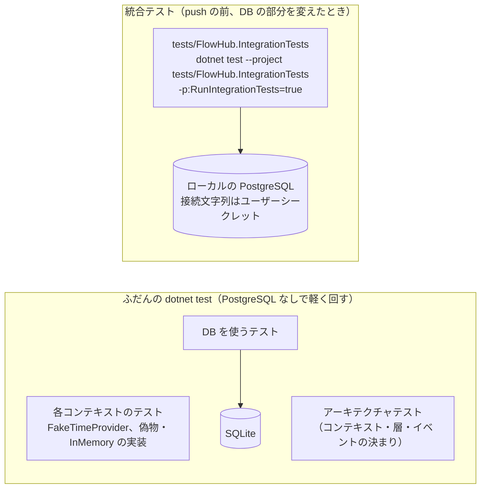

# E20. 配置図（本番・デバッグ・テスト）

本番、開発とデバッグ（シミュレーター）、テストで、何をどうつなぐかの違いです。

- 根拠：[CLAUDE.md](../../CLAUDE.md)「外部とのやり取りと時刻」「ルール」、`src/FlowHub.Api/appsettings*.json`、`src/FlowHub.Api/Database/DatabaseOptions.cs`、`tests/FlowHub.IntegrationTests/README.md`

## 本番

- 上は目指す形です。装置・ステーション・上位システムとの通信の方式が決まっていないので、**今の組み立て（`FlowHubSystem`）は、本番の設定でもシミュレーターをつないでいます**。方式が決まったら、本物との通信の実装に差し替えます。

## 開発・デバッグ（シミュレーター）

- シミュレーター用のデータが本番のデータと混ざらないよう、DB の接続先は環境ごとに分けます。
- シミュレーターの待ち時間（装置・ステーションの受け渡し、出庫、補充）は、`Simulator` の設定で変えます。

## テスト

## 環境ごとの違い

| 項目 | 本番 | 開発・デバッグ | テスト |
|---|---|---|---|
| DB | PostgreSQL（コンテキストごとにスキーマ） | SQLite（コンテキストごとにファイル） | SQLite（統合テストだけ PostgreSQL） |
| テーブルの作り方 | マイグレーション | `EnsureCreated` | `EnsureCreated`（統合テストはマイグレーション） |
| 装置・ステーション・上位システム | 本物との通信（方式は未定） | シミュレーター | 偽物 |
| 現在時刻 | `TimeProvider.System` | `TimeProvider.System` | `FakeTimeProvider` |
| 起動したときの運転状態 | 停止 | スタート（設定） | テストごと |
| 初期データ | － | `InitialData/initial-data.json` | テストごと |
